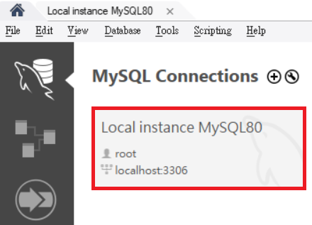
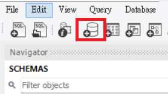
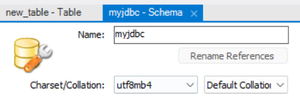
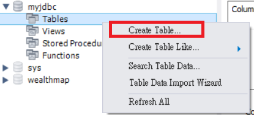
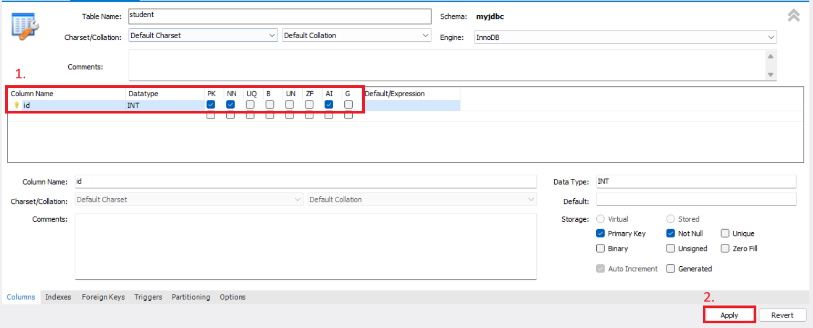
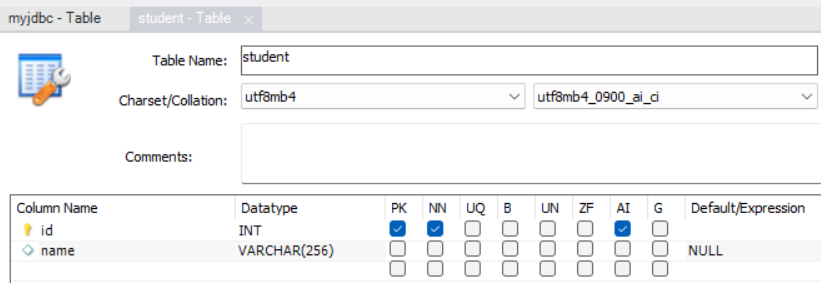
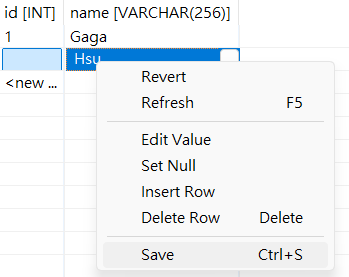

<div class="flex flex-col justify-center items-center h-full" style="background: #ffffff;">
  <p style="color: #5eada0; font-size: 1rem; font-weight: 600; letter-spacing: 0.2em; text-transform: uppercase; margin-bottom: 1.2rem;">
    Spring Boot Backend Masterclass
  </p>
  <h1 style="color: #1a5c5c; font-size: 2.8rem; font-weight: 900; line-height: 1.15; margin-bottom: 1.5rem;">
    資料庫連線設定<br>Eclipse 資料庫管理工具介紹
  </h1>
  <div style="height: 4px; width: 320px; background: linear-gradient(90deg, #5eada0, #a7d9d0); border-radius: 2px; margin-bottom: 1.5rem;"></div>
  <p style="color: #4a7c7c; font-size: 1.15rem; font-style: italic;">
    「讓 Spring Boot 和 MySQL 建立連線，開始操作資料」
  </p>
  <Link to="home" style="color: #9dc4c4; font-size: 0.85rem; margin-top: 2rem; text-decoration: none; letter-spacing: 0.05em;">← 返回目錄</Link>
</div>

<!--
大家好，歡迎來到第二十三章。

上一章我們認識了教務處的檔案室，也就是資料庫；還有負責跑檔案室的承辦人員，Spring JDBC。

但是承辦人員現在還進不了檔案室：他不知道檔案室在哪裡，也沒有門禁卡。今天就來把這些準備好。
-->

---

# 今天要完成的三件事

<v-clicks>

- **整理檔案室**：在 MySQL 裡開一個檔案櫃、放一本學籍簿
- **申請門禁**：告訴 Spring Boot 檔案室在哪裡、帳號密碼是什麼
- **裝一扇觀察窗**：在 Eclipse 裡直接看資料庫的內容

</v-clicks>

<!--
今天是設定的一章，要完成三件事。

（下一步）第一，整理檔案室。在 MySQL 裡開一個檔案櫃、放一本學籍簿。

（下一步）第二，申請門禁。告訴 Spring Boot 檔案室在哪裡、帳號密碼是什麼。

（下一步）第三，裝一扇觀察窗。讓我們在 Eclipse 裡就能直接看資料庫的內容。

今天的步驟比較多，但是每一步都只是照著填。跟著做一次就好。
-->

---
layout: section
class: flex flex-col justify-center items-center text-center
---

# Part 1
# 進檔案室之前，要準備什麼？

<!--
先用故事看一下，今天到底在準備什麼。
-->

---

# 承辦人員第一天上班

<Pairs left="教務處" right="程式" rows="cabinet,檔案室裡專屬我們的一個檔案櫃=server,Schema（一個資料庫）：myjdbc|book,檔案櫃裡的學籍簿，先畫好欄位=doc,Table（資料表）：student，有 id 和 name|shop,檔案室的地址=code,連線網址（url）|key,門禁卡的帳號和密碼=code,username、password" />

<v-click>

<div class="mt-4 p-3 bg-blue-50 border-l-4 border-blue-400 text-gray-700 text-left">
💡 前兩項在 <b>MySQL</b> 裡準備，後兩項寫在 <b>Spring Boot</b> 的設定檔裡。
</div>

</v-click>

<!--
承辦人員第一天上班，要先準備四樣東西。

（下一步）第一，檔案室很大，很多單位共用。我們要先有一個專屬的檔案櫃。對應到 MySQL，這叫 Schema，也就是一個資料庫。我們取名叫 myjdbc。

（下一步）第二，檔案櫃裡要有一本學籍簿，而且要先畫好欄位。對應到資料表 Table。我們建一張 student 表，有 id 和 name 兩個欄位。

（下一步）第三，承辦人員要知道檔案室的地址，這是連線網址。

（下一步）第四，門禁卡的帳號和密碼。

（下一步）前兩項是在 MySQL 裡準備，後兩項是寫在 Spring Boot 的設定檔裡。我們照這個順序來做。
-->

---
layout: section
class: flex flex-col justify-center items-center text-center
---

# Part 2
# 整理檔案室：建立 Schema 和 Table

<!--
先到 MySQL 裡，把檔案櫃和學籍簿準備好。我們用 MySQL Workbench 這個工具。
-->

---

# 建立 Schema（1）：進入 MySQL Workbench

開啟 MySQL Workbench，點選本機連線 **Local instance** 進入：



<!--
第一步，開啟 MySQL Workbench。

畫面上會看到一個 Local instance 的方塊，這是你自己電腦上的 MySQL。點它進去。
-->

---

# 建立 Schema（2）：按下建立按鈕

點上方工具列的 **Create a new schema**（圓柱加上一個加號的圖示）：



<!--
進來之後，在上方的工具列找一個「圓柱加上加號」的圖示。

滑鼠移上去會顯示 Create a new schema。點它。
-->

---

# 建立 Schema（3）：填寫並套用

<div class="grid grid-cols-2 gap-4">
<div>

1. `Schema Name` 填 `myjdbc`
2. Charset 選 `utf8mb4`，Collation 保持預設
3. 按 **Apply** → 再按 **Apply** → **Finish**

<div class="mt-3 p-3 bg-blue-50 border-l-4 border-blue-400 text-gray-700 text-sm">
💡 <code>myjdbc</code> 這個名字等一下會寫進連線網址，兩邊要一樣。
</div>

</div>
<div>



</div>
</div>

<!--
這個畫面要填三樣東西。

第一，Schema Name 填 myjdbc。

第二，Charset 選 utf8mb4。它讓資料庫可以正確存中文和各種符號。Collation 保持預設就好。

第三，按 Apply。Workbench 會先給你看它準備執行的 SQL，確認沒問題再按一次 Apply，最後按 Finish。

建好之後，左邊的 SCHEMAS 清單會出現 myjdbc。記住這個名字，等一下會寫進連線網址，兩邊要一樣。
-->

---

# 建立 Table（1）：開啟建立視窗

1. 左側展開 `myjdbc` → 在 `Tables` 上按右鍵 → **Create Table...**
2. `Table Name` 填 `student`



<!--
檔案櫃有了，接著放一本學籍簿進去。

在左邊找到 myjdbc，展開它。在 Tables 上按右鍵，選 Create Table。

Table Name 填 student。之後寫 SQL 的時候，用的就是這個名字。
-->

---

# 建立 Table（2）：畫好欄位

1. 新增兩個欄位：`id` 和 `name`
2. 勾選 `id` 的 **PK**（Primary Key）和 **AI**（Auto Increment）
3. 按 **Apply** → 再按 **Apply** → **Finish**



<!--
接著畫學籍簿的欄位。

新增兩個欄位：id 和 name。

id 那一列要勾兩個選項。PK 是 Primary Key，意思是這個欄位用來辨認每一筆資料，不能重複，就像學號。AI 是 Auto Increment，意思是自動編號，新增資料的時候不用自己填，資料庫會自動給下一個號碼。

設定好之後一樣按 Apply、Apply、Finish。
-->

---

# 建立 Table（3）：我們的學籍簿

| 欄位 | 資料型態 | 設定 | 說明 |
| --- | --- | --- | --- |
| `id` | `INT` | PK、AI | 學號：自動編號，不用自己填 |
| `name` | `VARCHAR(256)` | | 學生姓名 |



<!--
這就是我們的學籍簿，接下來好幾章都會用它。

id 是整數，設定了 PK 和 AI，所以是自動編號。

name 是文字，最多 256 個字，用來放學生姓名。

因為 id 會自動編號，之後新增學生的時候，只要給 name 就可以了。
-->

---
layout: section
class: flex flex-col justify-center items-center text-center
---

# Part 3
# 申請門禁：設定資料庫連線

<!--
檔案室整理好了。接著回到 Spring Boot，幫承辦人員申請門禁。
-->

---

# Step 1：在 build.gradle 加入兩個工具

```groovy
implementation 'org.springframework.boot:spring-boot-starter-jdbc'
implementation 'com.mysql:mysql-connector-j'
```

<v-clicks>

- `spring-boot-starter-jdbc`：承辦人員本人，也就是 Spring JDBC
- `mysql-connector-j`：MySQL 的**驅動程式**（Driver），像一位翻譯，讓 Java 能和 MySQL 溝通

</v-clicks>

<v-click>

<div class="mt-4 p-3 bg-yellow-50 border-l-4 border-yellow-400 text-gray-700 text-left">
⚠️ 改完 build.gradle，要在專案上按右鍵 → <code>Gradle</code> → <code>Refresh Gradle Project</code> 才會生效。
</div>

</v-click>

<!--
第一步，在 build.gradle 的 dependencies 裡加入兩行。

（下一步）第一行是 spring-boot-starter-jdbc。它就是承辦人員本人，加了它才有 Spring JDBC 可以用。

（下一步）第二行是 mysql-connector-j。它是 MySQL 的驅動程式，英文叫 Driver。可以把它想成一位翻譯：Java 和 MySQL 講的話不一樣，要靠它居中溝通。

（下一步）提醒一下：改完 build.gradle，要在專案上按右鍵，選 Gradle，再選 Refresh Gradle Project，Eclipse 才會去下載這兩個工具。
-->

---

# Step 2：填寫門禁申請表

在 `src/main/resources/application.properties` 加入四行：

<CodeSteps>

```properties {1|2|3-4|all}
spring.datasource.driver-class-name=com.mysql.cj.jdbc.Driver
spring.datasource.url=jdbc:mysql://localhost:3306/myjdbc?serverTimezone=Asia/Taipei&characterEncoding=utf-8
spring.datasource.username=root
spring.datasource.password=（你的 MySQL 密碼）
```

- 用哪一位翻譯：固定寫法，照抄就好
- 檔案室的地址：下一頁拆開來看
- 門禁卡的帳號和密碼
- Spring Boot 啟動時會讀這四行，自動連上資料庫

</CodeSteps>

<!--
第二步，填寫門禁申請表。這張表就是 application.properties 這個設定檔，位置在 src/main/resources 底下。加入四行。

（下一步）第一行，driver-class-name，指定用哪一位翻譯。這是固定寫法，照抄就好。

（下一步）第二行，url，是檔案室的地址。這一行比較長，下一頁拆開來看。

（下一步）第三、第四行是門禁卡的帳號和密碼。帳號用 root，密碼填你安裝 MySQL 時自己設定的那一組。

（下一步）Spring Boot 啟動的時候會讀這四行，自動連上資料庫。我們不用再寫任何連線的程式。
-->

---

# 把檔案室的地址拆開來看

<UrlParts parts="jdbc:mysql://;;連線方式;;怎麼去;;用 JDBC 連一個 MySQL 資料庫。固定寫法||localhost;;主機;;哪一棟樓;;MySQL 裝在哪一台電腦。localhost 是「我自己這台」||:3306;;埠號;;幾號門;;MySQL 預設開在 3306 這個門||/myjdbc;;Schema;;哪一個檔案櫃;;剛才在 Workbench 建立的 myjdbc，名字要一模一樣||?serverTimezone=…;;參數;;備註;;兩個常用的備註：時區用台北、文字用 utf-8，避免時間錯誤和中文亂碼" />

<!--
這一行地址，和第十四章學的網址長得很像。我們一段一段拆開。

（下一步）最前面 jdbc:mysql，意思是用 JDBC 去連一個 MySQL 資料庫。固定寫法。

（下一步）localhost 是主機，MySQL 裝在哪一台電腦。localhost 代表我自己這台。

（下一步）3306 是埠號。MySQL 預設開在 3306 這個門。

（下一步）/myjdbc 是 Schema 的名字，也就是哪一個檔案櫃。它要和剛才在 Workbench 建立的名字一模一樣。

（下一步）問號後面是兩個備註。serverTimezone 把時區設成台北，避免時間差八小時。characterEncoding 設成 utf-8，避免中文變成亂碼。這兩個幾乎每次都會加。
-->

---

# 想一想

<Poll question="啟動 Spring Boot 時出現「連不上資料庫」的錯誤，下面哪一個「不是」常見的原因？" options="password 打錯了|url 裡的 Schema 名稱拼錯了|MySQL 沒有啟動|Controller 少寫了 @RestController" answer="4" />

<!--
來想一題。

啟動 Spring Boot 的時候，如果出現連不上資料庫的錯誤，下面哪一個不是常見的原因？

（等大家作答）

（下一步）答案是第四個。Controller 有沒有寫 @RestController，和資料庫連線沒有關係。

前三個才是最常見的原因：密碼打錯、Schema 名稱拼錯、MySQL 根本沒有啟動。以後遇到連線失敗，先檢查這三件事。
-->

---

# 加碼設定：讓 SQL 顯示在 Console

```properties
# 印出執行的 SQL
logging.level.org.springframework.jdbc.core.JdbcTemplate=DEBUG
# 連參數的值也印出來（可選）
logging.level.org.springframework.jdbc.core.StatementCreatorUtils=TRACE
```

<v-clicks>

- 第一行：每次執行 SQL，Console 都會印出那一句 SQL
- 第二行：連帶入的參數值也一起印出來
- 只在開發的時候開，正式上線要關掉

</v-clicks>

<!--
最後多加兩行設定，之後找問題會很方便。

（下一步）第一行讓 Spring JDBC 每次執行 SQL 的時候，都把那一句 SQL 印在 Console。等於承辦人員每送一張申請單，都唸給我們聽。

（下一步）第二行會連帶入的參數值也一起印出來。

（下一步）這兩行只在開發的時候開。正式上線要關掉，因為印太多會拖慢速度，也可能把資料洩漏在紀錄裡。

現在還沒執行任何 SQL，所以看不到效果。下一章就會看到了。

另外提醒：網路上常看到 spring.jpa.show-sql=true，那是之後 JPA 用的。現在用 Spring JDBC，寫了不會有效果。
-->

---
layout: section
class: flex flex-col justify-center items-center text-center
---

# Part 4
# 裝一扇觀察窗：Data Source Explorer

<!--
門禁申請好了。最後在 Eclipse 裡裝一扇觀察窗，讓我們隨時能看檔案室裡的資料。
-->

---

# Data Source Explorer 是什麼？

<v-clicks>

- Eclipse 裡的一個面板，可以**直接連上資料庫**
- 能看有哪些資料表、裡面有哪些資料，也能改資料
- 寫完程式後，不用切換到別的軟體，就能確認資料有沒有存進去

</v-clicks>

<v-click>

<div class="mt-4 p-3 bg-blue-50 border-l-4 border-blue-400 text-gray-700 text-left">
💡 它和 MySQL Workbench 做的事差不多，只是直接放在 Eclipse 裡。想繼續用 Workbench 看資料也完全可以。
</div>

</v-click>

<!--
Data Source Explorer 是 Eclipse 裡的一個面板。

（下一步）它可以直接連上資料庫。

（下一步）可以看有哪些資料表、裡面有哪些資料，也能直接改資料。

（下一步）好處是：寫完程式之後，不用切換到別的軟體，就能確認資料有沒有存進去。

（下一步）它和 MySQL Workbench 做的事差不多，只是直接放在 Eclipse 裡。如果你習慣用 Workbench 看資料，也完全可以，這一段就當作參考。
-->

---

# 先確認有沒有這個面板

1. `Window` → `Show View` → `Other...`
2. 在搜尋框輸入 `Data Source`
3. 有出現 `Data Source Explorer` → 選它，按 `Open`
4. 沒有出現 → 要先安裝（下一頁）

<div class="mt-4 p-3 bg-yellow-50 border-l-4 border-yellow-400 text-gray-700 text-left">
⚠️ 有些 Eclipse 版本（例如 Eclipse IDE for Java Developers）預設沒有這個面板。
</div>

<!--
先確認你的 Eclipse 有沒有這個面板。

從上方選單點 Window，選 Show View，再選 Other。

在搜尋框輸入 Data Source。

如果有出現 Data Source Explorer，選它，按 Open，面板就打開了。

如果沒有出現，代表你的 Eclipse 還沒有安裝這個功能。有些比較精簡的 Eclipse 版本預設沒有。照下一頁安裝就可以。
-->

---

# 沒有的話：安裝 Database Development

1. `Help` → `Install New Software...`
2. `Work with` 選 `--All Available Sites--`（載入要等一下）
3. 勾選整個 **Database Development**
4. `Next` → 接受授權 → `Finish`
5. 安裝完成後，重新啟動 Eclipse

<div class="mt-4 p-3 bg-green-50 border-l-4 border-green-400 text-gray-700 text-left">
✅ 重新啟動後，再做一次上一頁的步驟，就找得到 Data Source Explorer 了。
</div>

<!--
安裝的方法是這樣。

從上方選單點 Help，選 Install New Software。

Work with 的下拉選單選 All Available Sites。清單載入要等一下。

找到 Database Development 這個分類，整個勾起來。

按 Next，接受授權，按 Finish。

安裝大概要三到五分鐘。完成後 Eclipse 會請你重新啟動。

重新啟動之後，再做一次上一頁的步驟，就找得到 Data Source Explorer 了。
-->

---

# 建立連線（1）：新增 MySQL 連線

1. 在 `Database Connections` 上按右鍵 → `New...`
2. 清單裡選 `MySQL`，名稱填 `myjdbc`，按 `Next`
3. 在 Drivers 欄位旁邊按 `+`，選 `MySQL JDBC Driver`
4. 切到 `JAR List` 頁籤，按 **Clear All**
5. 按 **Add JAR/Zip...**，選 `mysql-connector-j-[版本].jar`，按 `OK`

<div class="mt-4 p-3 bg-yellow-50 border-l-4 border-yellow-400 text-gray-700 text-sm text-left">
⚠️ 這個 jar 檔在 <code>C:\Users\[使用者名稱]\.gradle\caches\</code> 底下，用檔案總管搜尋 <code>mysql-connector-j</code> 就找得到。
</div>

<!--
面板打開之後，來建立一條連到 MySQL 的連線。

在 Database Connections 上按右鍵，選 New。

清單裡選 MySQL。名稱可以填 myjdbc，方便辨認。按 Next。

接著要告訴 Eclipse 用哪一位翻譯，也就是 Driver。在 Drivers 欄位旁邊按加號，選 MySQL JDBC Driver。

切到 JAR List 這個頁籤。裡面預設有一個檔名，但是那個檔案其實不存在。所以先按 Clear All 把它清掉。

再按 Add JAR/Zip，選我們真正的驅動程式檔案：mysql-connector-j 加上版本號的 jar 檔。

這個檔案在哪裡？剛才 Gradle 已經幫我們下載了，放在使用者資料夾的 .gradle\caches 底下。用檔案總管搜尋 mysql-connector-j 就找得到。
-->

---

# 如果看到這個錯誤

`Unable to locate JAR/zip ... mysql-connector-java-4.0.0-bin.jar`

<v-clicks>

- **原因**：`JAR List` 裡預設的那個檔名並不存在
- **解法**：回到 `JAR List` → **Clear All** → **Add JAR/Zip...** 選真正的 jar 檔

</v-clicks>

<!--
如果你在設定的時候看到這個錯誤，不用緊張，這很常見。

（下一步）原因是 JAR List 裡預設的那個檔名，在你的電腦上並不存在。

（下一步）解法就是上一頁的第四、第五步：回到 JAR List，按 Clear All，再按 Add JAR/Zip 選真正的 jar 檔。
-->

---

# 建立連線（2）：填入連線資訊並測試

和 `application.properties` 填的是同一組資料：

| 欄位 | 填入內容 |
| --- | --- |
| Database | `myjdbc` |
| URL | `jdbc:mysql://localhost:3306/myjdbc` |
| User name | `root` |
| Password | 你的 MySQL 密碼 |

<div class="mt-4 p-3 bg-green-50 border-l-4 border-green-400 text-gray-700 text-left">
✅ 按 <b>Test Connection</b>，出現 <b>Ping Succeeded</b> 就是成功了，再按 <code>Finish</code>。
</div>

<!--
Driver 設定好之後，填入連線資訊。這四個欄位，和剛才 application.properties 填的是同一組資料。

Database 填 myjdbc。URL 填 jdbc:mysql://localhost:3306/myjdbc。帳號 root，密碼是你的 MySQL 密碼。

填完之後按 Test Connection。如果出現 Ping Succeeded，就是連線成功了，再按 Finish。

如果失敗，一樣先檢查那三件事：密碼、Schema 名稱、MySQL 有沒有啟動。
-->

---

# 看看檔案室裡的資料

1. 展開連線 → `myjdbc` → 找到 `student` 資料表
2. 在資料表上按右鍵 → **Edit**，就能看到裡面的資料



<div class="mt-4 p-3 bg-green-50 border-l-4 border-green-400 text-gray-700 text-left">
✅ 下一章用程式新增學生之後，就可以來這裡確認資料有沒有真的存進去。
</div>

<!--
連線成功之後，展開它，找到 myjdbc，再找到 student 資料表。

在資料表上按右鍵，選 Edit，就能看到裡面的資料，也可以直接在這裡新增或修改。

現在資料表是空的。下一章我們用程式新增學生之後，就可以來這裡確認資料有沒有真的存進去。
-->

---

# 複習：教務處對照表

<Pairs left="教務處" right="程式" rows="cabinet,專屬的檔案櫃=server,Schema：myjdbc|book,畫好欄位的學籍簿=doc,Table：student（id、name）|staff,翻譯=code,Driver：mysql-connector-j|key,門禁申請表：地址、帳號、密碼=code,application.properties 的四行設定|what,觀察窗=code,Data Source Explorer" />

<!--
我們用一張圖複習今天做的事。

（下一步）專屬的檔案櫃，是 Schema，名字叫 myjdbc。

（下一步）畫好欄位的學籍簿，是 student 資料表，有 id 和 name。

（下一步）翻譯，是 MySQL 的 Driver。

（下一步）門禁申請表，是 application.properties 裡的四行設定。

（下一步）觀察窗，是 Eclipse 的 Data Source Explorer。
-->

---

# 章節總結

<v-clicks>

- **MySQL**：用 Workbench 建立 Schema `myjdbc` 和資料表 `student`
- **build.gradle**：加入 `spring-boot-starter-jdbc` 和 `mysql-connector-j`
- **application.properties**：driver、url、username、password 四行
- **url 的格式**：`jdbc:mysql://主機:埠號/Schema名稱?參數`
- **看 SQL**：`logging.level…JdbcTemplate=DEBUG`，只在開發時開
- **看資料**：Data Source Explorer 或 MySQL Workbench 都可以

</v-clicks>

<v-click>

下一章，承辦人員正式上工：用 Spring JDBC 新增、修改、刪除資料。

</v-click>

<!--
最後整理今天的重點。

（依序按下一步）在 MySQL 建立 Schema 和資料表。在 build.gradle 加入兩個工具。在 application.properties 寫四行連線設定。url 的格式是主機、埠號、Schema 名稱，再加參數。想看執行的 SQL，就加 logging 的設定。想看資料，用 Data Source Explorer 或 Workbench 都可以。

（最後一步）下一章，承辦人員正式上工：我們要用 Spring JDBC 新增、修改、刪除資料。
-->

---
layout: end
---

# Q & A

有任何問題嗎？

<!--
今天的內容到這邊。

課後請確認兩件事：Spring Boot 可以正常啟動、沒有連線的錯誤；而且你有辦法看到 student 這張資料表。這樣下一章就可以直接開始寫程式。

有任何問題歡迎提出來。
-->
