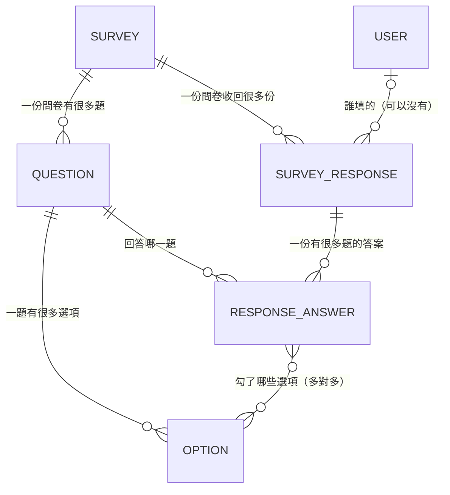

<div class="flex flex-col justify-center items-center h-full" style="background: #ffffff;">
  <p style="color: #5eada0; font-size: 1rem; font-weight: 600; letter-spacing: 0.2em; text-transform: uppercase; margin-bottom: 1.2rem;">
    Spring Boot Project Practice
  </p>
  <h1 style="color: #1a5c5c; font-size: 3.8rem; font-weight: 900; line-height: 1.15; margin-bottom: 1.5rem;">
    實戰專題（一）<br>專案總覽與資料模型
  </h1>
  <div style="height: 4px; width: 320px; background: linear-gradient(90deg, #5eada0, #a7d9d0); border-radius: 2px; margin-bottom: 1.5rem;"></div>
  <p style="color: #4a7c7c; font-size: 1.15rem; font-style: italic;">
    「動態問卷系統：先把資料表設計好」
  </p>
  <Link to="home" style="color: #9dc4c4; font-size: 0.85rem; margin-top: 2rem; text-decoration: none; letter-spacing: 0.05em;">← 返回目錄</Link>
</div>

<!--
大家好，歡迎來到第四十九章，也是最後一個單元「實戰專題」的第一章。

前面四十八章，我們一樣一樣學了 Spring Boot 的功能。這個單元要把它們組起來，做出一個完整、真的能用的系統：動態問卷系統。

專題分成五章。第四十九到五十二章做後端，第五十三章做前端。今天先看整個專題要做什麼，然後建立專案、設計資料表。
-->

---

# 今天要完成的三件事

<v-clicks>

- **看懂專題**：問卷系統有哪些人、要做哪些事
- **建立專案**：資料庫、依賴、設定檔、資料夾
- **設計資料表**：六個 Entity 和三個 Repository

</v-clicks>

<!--
今天要完成三件事。

（下一步）第一，看懂專題。問卷系統有哪些人在用，各自要做哪些事。

（下一步）第二，建立專案。資料庫、依賴、設定檔，還有資料夾的安排。

（下一步）第三，設計資料表。這是今天的重點：六個 Entity，和三個 Repository。資料表設計好了，後面三章的功能才有地方放。
-->

---
layout: section
class: flex flex-col justify-center items-center text-center
---

# Part 1
# 教務處要做線上問卷

<!--
先看這個專題要解決什麼問題。
-->

---

# 紙本問卷的麻煩

教務處每學期都要做很多調查：課程意見、社團滿意度、畢業生去向……

<v-clicks>

- 印好、發下去、收回來，一疊一疊的紙
- 統計要一張一張數：選 A 的幾個人、選 B 的幾個人
- 同一個人填了兩次，很難發現
- 想知道「Tom 去年填過哪些問卷」，要翻遍所有的紙

</v-clicks>

<v-click>

<div class="mt-4 p-3 bg-blue-50 border-l-4 border-blue-400 text-gray-700 text-left">
💡 這個專題要做的，就是把整件事搬到網路上：<b>管理員</b>線上出題、<b>任何人</b>線上填寫、系統<b>自動統計</b>。
</div>

</v-click>

<!--
教務處每學期都要做很多調查。課程意見、社團滿意度、畢業生去向等等。

（下一步）用紙本做，要印好、發下去、收回來，一疊一疊的紙。

（下一步）統計的時候要一張一張數：選 A 的幾個人，選 B 的幾個人。

（下一步）同一個人填了兩次，很難發現。

（下一步）想知道 Tom 去年填過哪些問卷，要翻遍所有的紙。

（下一步）這個專題要做的，就是把整件事搬到網路上。管理員線上出題，任何人線上填寫，系統自動統計。
-->

---

# 三種人，各做什麼

<v-clicks>

- **訪客**（不用登入）：看進行中的問卷 → 填寫 → 確認頁再看一次 → 送出
- **會員**（登入後）：除了填寫，還能看「我填過哪些問卷」、修改個人資料
- **管理員**：新增、修改、刪除問卷；發佈和下架；看填寫名單、每一份的答案、統計結果

</v-clicks>

<v-click>

<div class="mt-4 p-3 bg-blue-50 border-l-4 border-blue-400 text-gray-700 text-left">
💡 題目有三種：<b>單選</b>（SINGLE）、<b>多選</b>（MULTI）、<b>簡答</b>（TEXT）。題目的數量和選項，都由管理員自己決定，所以叫做「動態」問卷。
</div>

</v-click>

<!--
系統有三種人在用。

（下一步）第一種是訪客，不用登入。可以看進行中的問卷，填寫，然後在確認頁再看一次自己填的內容，最後送出。

（下一步）第二種是會員，也就是登入的人。除了填寫，還能看「我填過哪些問卷」，也可以修改個人資料。

（下一步）第三種是管理員。可以新增、修改、刪除問卷，發佈和下架。還可以看填寫名單、每一份的答案，以及統計結果。

（下一步）題目有三種：單選、多選、簡答。英文代碼分別是 SINGLE、MULTI、TEXT。一份問卷有幾題、每題有哪些選項，都由管理員自己決定。所以叫做動態問卷。
-->

---

# 整個系統的樣子

<Flow nodes="前端:Angular :4200|Controller:櫃台|Service:組長|Repository:助理|MySQL:檔案室" steps="1>2:HTTP + JSON（帶著通行證）|2>3:呼叫方法|3>4:存、查|4>5:SQL|5>4:資料|4>3:Entity|3>2:AppResponse|2>1:JSON" />

<v-click>

<div class="mt-4 p-3 bg-blue-50 border-l-4 border-blue-400 text-gray-700 text-left">
💡 前端和後端是<b>兩個獨立的專案</b>，跑在不同的 Port。第四十九到五十二章只做後端，全部用 Postman 測試；第五十三章再做前端。
</div>

</v-click>

<!--
整個系統的樣子。左邊是前端，用 Angular 寫，跑在 4200。右邊是我們熟悉的三層架構和資料庫。

（下一步）前端用 HTTP 送出請求，內容是 JSON。登入之後，還會帶著第四十七章的通行證。

（下一步）櫃台收到之後，交給組長。

（下一步）組長請助理存或查資料。

（下一步）助理到檔案室執行 SQL。

（下一步）檔案室回傳資料。

（下一步）助理把資料變成 Entity 交給組長。

（下一步）組長把結果包成一種固定格式的回覆單，叫做 AppResponse。下一章會詳細介紹。

（下一步）櫃台把它變成 JSON 回給前端。

（下一步）前端和後端是兩個獨立的專案，跑在不同的 Port。第四十九到五十二章只做後端，全部用 Postman 測試。第五十三章再做前端。
-->

---

# 會用到哪些學過的東西

<Pairs left="功能" right="學過的章節" sign="→" rows="book,問卷、題目、選項的資料表=code,JPA 與資料表關聯（ch26–29）|form,DTO 和輸入檢查=code,資料物件、驗證（ch37、ch41）|card,統一回覆單、Stream=code,Java 語法補充（ch38）|guard,註冊、登入、只有管理員能用後台=code,Spring Security、JWT（ch46–47）|cabinet,填完先暫存、確認後再送出=code,Session（ch42）" />

<!--
這個專題會用到很多學過的東西。

（下一步）問卷、題目、選項的資料表，用的是 JPA，和第二十九章的資料表關聯。

（下一步）DTO 和輸入檢查，是第三十七章和第四十一章。

（下一步）統一的回覆單和 Stream，是第三十八章的 Java 語法補充。

（下一步）註冊、登入、只有管理員能用後台，是第四十六、四十七章的警衛和通行證。

（下一步）填完先暫存、確認後再送出，是第四十二章的置物櫃，Session。

遇到忘記的地方，可以回到那一章看看。
-->

---

# 想一想

<Poll question="一位沒有登入的訪客，在這個系統裡可以做哪一件事？" options="新增一份問卷|填寫進行中的問卷|看某份問卷的統計結果|看自己填過哪些問卷" answer="2" />

<!--
來想一題。

一位沒有登入的訪客，在這個系統裡可以做哪一件事？

（等大家作答）

（下一步）答案是：填寫進行中的問卷。

新增問卷和看統計是管理員的事。看自己填過哪些問卷，要登入才知道「自己」是誰，所以是會員的功能。
-->

---
layout: section
class: flex flex-col justify-center items-center text-center
---

# Part 2
# 建立專案

<!--
來建立專案。
-->

---

# 先建一個空的資料庫

在 MySQL Workbench 執行：

```sql
CREATE DATABASE dynamic_survey
  DEFAULT CHARACTER SET utf8mb4
  DEFAULT COLLATE utf8mb4_unicode_ci;
```

<v-clicks>

- 只建資料庫，**不用建資料表**：`ddl-auto=update` 會照 Entity 自動建
- `utf8mb4`：讓中文和表情符號都能正常存放

</v-clicks>

<!--
先在 MySQL Workbench 建一個空的資料庫，叫做 dynamic_survey。

（下一步）只建資料庫，不用建資料表。和第三十九章一樣，設定檔會寫 ddl-auto 等於 update，啟動的時候助理會照 Entity 自動建好。

（下一步）後面兩行設定編碼。utf8mb4 讓中文和表情符號都能正常存放。問卷的內容很多是中文，這兩行請照寫。
-->

---

# 用 Spring Initializr 建立專案

<v-clicks>

- Project：**Gradle - Groovy**，Language：**Java**
- Artifact：**`dynamic-survey`**（Package 會變成 `com.example.dynamic_survey`）
- Dependencies：**Spring Web**、**Spring Data JPA**、**MySQL Driver**、**Validation**、**Spring Security**、**Lombok**

</v-clicks>

<v-click>

再到 `build.gradle` 的 `dependencies` 補上 JWT 的三行（第四十七章學過）：

```groovy
implementation 'io.jsonwebtoken:jjwt-api:0.13.0'
runtimeOnly 'io.jsonwebtoken:jjwt-impl:0.13.0'
runtimeOnly 'io.jsonwebtoken:jjwt-jackson:0.13.0'
```

</v-click>

<!--
用 Spring Initializr 建立專案，步驟和第三十九章一樣。

（下一步）Project 選 Gradle - Groovy，Language 選 Java。

（下一步）Artifact 填 dynamic-survey。中間是減號。Package 會自動變成 com.example.dynamic_survey，減號變成底線，因為 Java 的名稱不能有減號。

（下一步）Dependencies 加六個。Spring Web、Spring Data JPA、MySQL Driver、Validation、Spring Security、Lombok。每一個都學過。

（下一步）JWT 的套件 Initializr 找不到，要自己到 build.gradle 補上三行，和第四十七章一樣。補完記得對專案按右鍵，選 Gradle，再選 Refresh Gradle Project。
-->

---

# application.properties

```properties {1-3|4-5|6-7}
spring.datasource.url=jdbc:mysql://localhost:3306/dynamic_survey
spring.datasource.username=root
spring.datasource.password=root
spring.jpa.hibernate.ddl-auto=update
spring.jpa.show-sql=true
jwt.secret=dynamic-survey-jwt-secret-key-please-change-me-2026
jwt.expire-minutes=60
```

<v-clicks>

- 資料庫的連線：帳號密碼請換成自己的
- 自動建表，並且在 Console 印出執行的 SQL
- 通行證的密鑰（至少 32 個字）和有效時間（分鐘）

</v-clicks>

<!--
application.properties 寫七行。

（下一步）前三行是資料庫的連線。網址最後是剛才建的 dynamic_survey。帳號密碼請換成自己電腦上的。

（下一步）中間兩行。ddl-auto 等於 update，自動建表。show-sql 等於 true，在 Console 印出執行的 SQL，方便我們觀察。

（下一步）最後兩行是通行證。jwt.secret 是密鑰，至少三十二個字。jwt.expire-minutes 是有效時間，單位是分鐘。這是第四十七章練習一的寫法。

原本的教材在這裡還有幾行日期格式的設定。現在的 Spring Boot 已經預設把日期轉成「2026-06-30」這種格式，所以不需要了。
-->

---

# 資料夾的安排

```text
com/example/dynamic_survey/
├── DynamicSurveyApplication.java
├── entity/       資料表：Survey、Question、Option、SurveyResponse、ResponseAnswer、User
├── repository/   助理：UserRepository、SurveyRepository、SurveyResponseRepository
├── dto/          前端送來、回給前端的資料
├── vo/           統一回覆單：AppResponse、RspCode
├── exception/    自己的例外：BizException
├── config/       全域例外處理：GlobalExceptionHandler
├── security/     警衛：SecurityConfig、JwtUtil、JwtAuthFilter
├── service/      組長：AuthService、SurveyService
└── controller/   櫃台：AuthController、UserController、AdminSurveyController、SurveyController
```

<v-click>

<div class="mt-4 p-3 bg-blue-50 border-l-4 border-blue-400 text-gray-700 text-left">
💡 今天做 <code>entity</code> 和 <code>repository</code>；下一章做 <code>vo</code>、<code>exception</code>、<code>config</code>、<code>security</code> 和登入；最後兩章做問卷的 Service 和 Controller。
</div>

</v-click>

<!--
先看整個專案的資料夾怎麼安排。和第三十九章的 school 專案很像，多了幾個資料夾。

entity 放資料表。repository 放助理。dto 放前端送來和回給前端的資料。vo 放統一的回覆單。exception 放自己做的例外。config 放全域的例外處理。security 放警衛的守則和通行證。service 是組長，controller 是櫃台。

（下一步）今天做 entity 和 repository。下一章做 vo、exception、config、security，還有註冊和登入。最後兩章做問卷的 Service 和 Controller。
-->

---
layout: section
class: flex flex-col justify-center items-center text-center
---

# Part 3
# 一份問卷，拆成幾本簿子？

<!--
今天的重點：資料表怎麼設計。
-->

---

# 把一份紙本問卷拆開來看

<Pairs left="紙本問卷" right="Entity" rows="doc,一份問卷（標題、開放日期）=code,Survey|form,問卷上的每一題=code,Question|ok,每一題的選項=code,Option|card,一份填好、交回來的問卷=code,SurveyResponse|what,交回來的問卷上，每一題的答案=code,ResponseAnswer|you,填寫的會員=code,User" />

<!--
拿一份紙本問卷來拆。

（下一步）一份問卷，上面有標題、開放日期。它是 Survey。

（下一步）問卷上的每一題，是 Question。

（下一步）每一題的選項，是 Option。

（下一步）有人填好、交回來的一份問卷，是 SurveyResponse。注意：空白的問卷只有一份，填好交回來的可以有很多份。

（下一步）交回來的問卷上，每一題的答案，是 ResponseAnswer。

（下一步）填寫的人如果是會員，就連到 User。

六樣東西，就是六個 Entity。
-->

---

# 它們之間的關係



<!--
這張圖畫出六個 Entity 之間的關係。線的兩端，一條線代表「一」，像鳥腳的分岔代表「多」。

由上往下看。一份問卷有很多題，一題有很多選項。這兩個都是第二十九章的一對多，就像成績單和科目成績。

一份問卷會收回很多份作答。一份作答有很多題的答案。每一個答案，回答的是某一題。

比較特別的是答案和選項。多選題的一個答案，可以勾很多個選項；一個選項，也會被很多人勾。所以是多對多，要一張對照表，就像第二十九章的成績單和獎項。

最後，作答和會員。會員可以填很多份。但是訪客也能填，所以這條關係可以是空的。
-->

---

# 想一想

<Poll question="「這一題屬於哪一份問卷」的外鍵 survey_id，應該放在哪一張資料表？" options="surveys（問卷）|questions（題目）|兩張都要放|另外開一張對照表" answer="2" />

<!--
來想一題。

「這一題屬於哪一份問卷」的外鍵 survey_id，應該放在哪一張資料表？

（等大家作答）

（下一步）答案是 questions，題目這一張。

第二十九章的口訣：外鍵永遠在「多」的那一邊。一份問卷有很多題，題目是多的那一邊，所以每一題記著自己屬於哪一份問卷。
-->

---

# Survey：問卷

<CodeSteps>

```java {1-2|3-4|6-7|8-9|11-14}
@Getter @Setter @Entity @Table(name = "surveys")
public class Survey {
    @Id @GeneratedValue(strategy = GenerationType.IDENTITY)
    private Long id;

    @Column(nullable = false, length = 50) private String title;
    @Column(length = 300) private String description;
    @Column(nullable = false) private LocalDate startDate;
    @Column(nullable = false) private LocalDate endDate;

    @Column(nullable = false) private String status;     // DRAFT / PUBLISHED
    @OneToMany(mappedBy = "survey", cascade = CascadeType.ALL, orphanRemoval = true)
    @OrderBy("orderIndex ASC")
    private List<Question> questions = new ArrayList<>();
}
```

- `@Table`：資料表的名字叫 `surveys`
- 主鍵用 `Long`：問卷系統的資料可能很多，用比較大的整數
- `@Column`：`nullable = false` 是必填，`length` 是最多幾個字
- 開放的日期用第三十八章的 `LocalDate`
- 狀態：草稿或已發佈；一份問卷有很多題，題目跟著問卷一起存、一起刪

</CodeSteps>

<!--
在 entity 資料夾新增 Survey。

（下一步）@Getter、@Setter、@Entity，都是熟悉的寫法。@Table 指定資料表的名字叫 surveys。為了放得下，註解寫在同一行，實際上可以照平常分行寫。

（下一步）主鍵。這次用 Long，不是 Integer。Long 是比較大的整數，資料可能很多的系統習慣用它。整個專題的主鍵都用 Long。

（下一步）標題和說明。@Column 是第二十六章學過的，nullable 等於 false 代表必填，length 是最多幾個字。標題必填、最多五十字；說明可以不填、最多三百字。

（下一步）開始和結束的日期，用第三十八章學的 LocalDate，只要日期，不用時間。

（下一步）status 是狀態，內容是 DRAFT 草稿，或 PUBLISHED 已發佈。下面是第二十九章的一對多：一份問卷有很多題。加了 cascade 和 orphanRemoval，題目跟著問卷一起存、一起刪。@OrderBy 讓題目拿出來的時候，照 orderIndex 排好順序。
-->

---

# Question：題目

```java
@Getter @Setter @Entity @Table(name = "questions")
public class Question {
    @Id @GeneratedValue(strategy = GenerationType.IDENTITY)
    private Long id;

    @ManyToOne(fetch = FetchType.LAZY)
    @JoinColumn(name = "survey_id", nullable = false)
    private Survey survey;

    @Column(nullable = false, length = 75) private String title;
    @Column(nullable = false) private String type;        // SINGLE / MULTI / TEXT
    @Column(nullable = false) private boolean required;   // 必答嗎
    @Column(nullable = false) private int orderIndex;     // 第幾題（從 0 開始）

    @OneToMany(mappedBy = "question", cascade = CascadeType.ALL, orphanRemoval = true)
    @OrderBy("orderIndex ASC")
    private List<Option> options = new ArrayList<>();
}
```

<!--
題目 Question。為了放得下，註解寫在同一行。

它有兩個關係。上面是多對一：每一題屬於一份問卷，外鍵是 survey_id，加上 LAZY。下面是一對多：一題有很多選項，一樣跟著一起存、一起刪，照順序排。

中間四個欄位：題目文字、題型、是不是必答、第幾題。
-->

---

# Option：選項

```java
@Getter @Setter @Entity @Table(name = "options")
public class Option {
    @Id @GeneratedValue(strategy = GenerationType.IDENTITY)
    private Long id;

    @ManyToOne(fetch = FetchType.LAZY)
    @JoinColumn(name = "question_id", nullable = false)
    private Question question;

    @Column(nullable = false) private String optionText;
    @Column(nullable = false) private int orderIndex;
}
```

<v-click>

<div class="mt-4 p-3 bg-blue-50 border-l-4 border-blue-400 text-gray-700 text-left">
💡 從 <code>Survey</code> 到 <code>Question</code> 到 <code>Option</code>，是兩層的一對多。存一份問卷，底下的題目和選項都會一起存。
</div>

</v-click>

<!--
選項 Option 很單純。多對一屬於某一題，外鍵是 question_id。加上選項的文字和順序。

（下一步）從 Survey 到 Question 到 Option，是兩層的一對多。存一份問卷，底下的題目和選項都會一起存，刪除也一樣。
-->

---

# SurveyResponse：一份交回來的問卷

<CodeSteps>

```java {6-8|10-14|16-18|20-21}
@Getter @Setter @Entity @Table(name = "survey_responses")
public class SurveyResponse {
    @Id @GeneratedValue(strategy = GenerationType.IDENTITY)
    private Long id;

    @ManyToOne(fetch = FetchType.LAZY)
    @JoinColumn(name = "survey_id", nullable = false)
    private Survey survey;

    @Column(nullable = false) private String name;
    @Column(nullable = false) private String phone;
    @Column(nullable = false) private String email;
    private Integer age;
    @Column(nullable = false) private LocalDateTime submittedAt;

    @ManyToOne(fetch = FetchType.LAZY)
    @JoinColumn(name = "user_id")
    private User user;           // 沒有登入就是 null

    @OneToMany(mappedBy = "surveyResponse", cascade = CascadeType.ALL, orphanRemoval = true)
    private List<ResponseAnswer> answers = new ArrayList<>();
}
```

- 這一份是哪一份問卷的
- 填寫人的資料直接存在這裡，訪客也能填；送出時間用 `LocalDateTime`
- 是哪一位會員填的：外鍵可以是空的，所以**沒有** `nullable = false`
- 這一份有很多題的答案，跟著一起存

</CodeSteps>

<!--
一份交回來的問卷，SurveyResponse。

（下一步）多對一：它是哪一份問卷的。

（下一步）填寫人的資料：姓名、手機、Email、年齡，直接存在這裡。這樣訪客不用註冊也能填。年齡用 Integer，可以是空的，所以是選填。送出時間要精確到時分秒，用 LocalDateTime。

（下一步）是哪一位會員填的。訪客填的話沒有會員，所以這個外鍵可以是空的。注意 @JoinColumn 這裡沒有寫 nullable 等於 false。

（下一步）一份作答有很多題的答案，一對多，跟著一起存。
-->

---

# ResponseAnswer：每一題的答案

```java {6-12|14-18|20-21}
@Getter @Setter @Entity @Table(name = "response_answers")
public class ResponseAnswer {
    @Id @GeneratedValue(strategy = GenerationType.IDENTITY)
    private Long id;

    @ManyToOne(fetch = FetchType.LAZY)
    @JoinColumn(name = "response_id", nullable = false)
    private SurveyResponse surveyResponse;

    @ManyToOne(fetch = FetchType.LAZY)
    @JoinColumn(name = "question_id", nullable = false)
    private Question question;

    @ManyToMany
    @JoinTable(name = "answer_selected_options",
            joinColumns = @JoinColumn(name = "answer_id"),
            inverseJoinColumns = @JoinColumn(name = "option_id"))
    private List<Option> selectedOptions = new ArrayList<>();

    @Column(columnDefinition = "TEXT")
    private String answerText;
}
```

<!--
每一題的答案，ResponseAnswer。

（下一步）兩個多對一。它屬於哪一份作答，以及它回答的是哪一題。

（下一步）單選和多選題，勾了哪些選項。這是第二十九章的多對多。對照表叫 answer_selected_options，一邊是答案的編號，一邊是選項的編號。

（下一步）answerText 放文字。簡答題的答案放這裡。選擇題也會把勾選的選項文字串起來放在這裡，之後顯示的時候比較方便。columnDefinition 等於 TEXT，讓資料庫用可以放很長文字的型別。
-->

---

# User：會員

```java
@Getter @Setter @Entity @Table(name = "users")
public class User {
    @Id @GeneratedValue(strategy = GenerationType.IDENTITY)
    private Long id;

    @Column(nullable = false, unique = true)
    private String email;        // 用 Email 當帳號

    @Column(nullable = false)
    private String password;     // 攪碎後的亂碼

    @Column(nullable = false) private String name;
    private String phone;

    @Column(nullable = false)
    private String role;         // USER / ADMIN
}
```

<v-click>

<div class="mt-4 p-3 bg-blue-50 border-l-4 border-blue-400 text-gray-700 text-left">
💡 <code>unique = true</code>：這一欄不能重複，同一個 Email 只能註冊一次。<code>role</code> 就是第四十六章的「身分」。
</div>

</v-click>

<!--
最後是會員 User。

email 當作登入的帳號。password 存的是第四十六章的攪碎機攪過的亂碼。姓名必填，電話選填。role 是身分：USER 一般會員，或 ADMIN 管理員。

（下一步）email 上面多了 unique 等於 true，意思是這一欄不能重複，同一個 Email 只能註冊一次。資料庫會幫我們把關。role 就是第四十六章說的身分。

第四十六章為了不和 Spring Security 的 User 撞名，我們取名 Account。原本的專題取名叫 User，這裡照原本的名字。下一章會看到撞名的時候怎麼處理。
-->

---

# 兩個和原教材不一樣的地方

<v-clicks>

- **Entity 用 `@Getter` + `@Setter`，不用 `@Data`**：第二十六章說過原因。這個專題的 Entity 互相連來連去，用 `@Data` 很容易在印出物件或比較物件時繞圈圈停不下來
- **狀態和題型用 `String`**：照第三十八章的說法，它們很適合用 `enum`。這裡維持原本的 `String`，因為前端送來的就是 `"PUBLISHED"`、`"SINGLE"` 這樣的文字，對照起來比較直接

</v-clicks>

<!--
說明兩個和原本教材不一樣的地方。

（下一步）第一，Entity 用 @Getter 加 @Setter，不用 @Data。第二十六章說過原因：@Data 會多產生幾個方法，其中有印出物件和比較物件的方法。這個專題的 Entity 互相連來連去，問卷連到題目，題目又連回問卷。用 @Data 的話，印出物件或比較物件的時候，很容易繞圈圈停不下來，和第二十九章轉 JSON 的問題一樣。

（下一步）第二，狀態和題型用 String。照第三十八章的說法，只有幾種固定的值，很適合用 enum。這裡維持原本的 String，因為前端送來的就是 PUBLISHED、SINGLE 這樣的文字，對照起來比較直接。有興趣的同學可以自己改成 enum 試試看。
-->

---
layout: section
class: flex flex-col justify-center items-center text-center
---

# Part 4
# 三個 Repository

<!--
Entity 寫好了，接著寫助理。
-->

---

# UserRepository

```java
public interface UserRepository extends JpaRepository<User, Long> {
    Optional<User> findByEmail(String email);
    boolean existsByEmail(String email);
}
```

<v-clicks>

- `findByEmail`：用 Email 找會員。回傳**信封**（`Optional`），之後可以用 `orElseThrow` 拆
- `existsByEmail`：這個 Email 有沒有人用過。方法名稱用 `existsBy` 開頭，回傳 `true` 或 `false`

</v-clicks>

<!--
在 repository 資料夾新增 UserRepository。主鍵是 Long，所以角括號裡寫 User 和 Long。

（下一步）findByEmail，用 Email 找會員。回傳的是第二十七章的信封 Optional。之後可以用第三十八章學的 orElseThrow 來拆：找不到就直接丟出例外。

（下一步）existsByEmail，問這個 Email 有沒有人用過。方法名稱用 existsBy 開頭，助理就會回傳 true 或 false。註冊的時候會用到。
-->

---

# SurveyRepository：兩張便條

```java {2-4|6-12}
public interface SurveyRepository extends JpaRepository<Survey, Long> {
    @Query("SELECT s FROM Survey s WHERE s.status = 'PUBLISHED' " +
           "AND s.startDate <= CURRENT_DATE AND s.endDate >= CURRENT_DATE")
    List<Survey> findActiveSurveys();

    @Query("SELECT s FROM Survey s WHERE " +
           "(:title IS NULL OR s.title LIKE %:title%) AND " +
           "(:startDate IS NULL OR s.startDate >= :startDate) AND " +
           "(:endDate IS NULL OR s.endDate <= :endDate)")
    List<Survey> findByFilters(@Param("title") String title,
                               @Param("startDate") LocalDate startDate,
                               @Param("endDate") LocalDate endDate);
}
```

<v-clicks>

- 進行中的問卷：已發佈，而且今天（`CURRENT_DATE`）在開放期間內
- 後台搜尋：三個條件都是**選填**。`:title IS NULL OR …` 的意思是「沒給就不管這個條件」
- `LIKE %:title%`：標題裡有包含這幾個字就算

</v-clicks>

<!--
SurveyRepository 有兩張便條，也就是第二十八章學的 @Query，用的是 JPQL。

（下一步）第一張，找進行中的問卷，前台首頁用。條件是：已發佈，而且今天在開放期間內。CURRENT_DATE 代表今天的日期。

（下一步）第二張，後台搜尋用。可以用標題、開始日期、結束日期來篩選。

（下一步）這三個條件都是選填。看第一個條件：冒號 title IS NULL，OR 後面才是真正的條件。意思是：如果沒有給標題，這個條件直接成立，等於不管它。給了的話，才比對標題。

（下一步）LIKE 是第二十八章的模糊查詢。百分比夾著 title，意思是標題裡有包含這幾個字就算。
-->

---

# SurveyResponseRepository：全部靠方法名稱

```java
public interface SurveyResponseRepository extends JpaRepository<SurveyResponse, Long> {
    List<SurveyResponse> findByUserOrderBySubmittedAtDesc(User user);
    List<SurveyResponse> findBySurveyId(Long surveyId);
    List<SurveyResponse> findBySurveyIdOrderByIdDesc(Long surveyId);
    boolean existsBySurveyId(Long surveyId);
    boolean existsBySurveyIdAndEmail(Long surveyId, String email);
}
```

<v-clicks>

- 某位會員填過的，照送出時間新到舊（個人紀錄）
- 某份問卷收回的全部作答（統計），以及照編號新到舊（填寫名單）
- 這份問卷有沒有人填過（有的話就不能刪、不能改）
- 這個 Email 有沒有填過這份問卷（不能重複填）

</v-clicks>

<!--
第三個，SurveyResponseRepository。五個方法全部靠方法名稱，不用寫便條。

（下一步）findByUser，加上 OrderBy 送出時間 Desc。某位會員填過的問卷，照送出時間新到舊。個人紀錄用。

（下一步）findBySurveyId，某份問卷收回的全部作答，統計用。這裡的 SurveyId 是第二十九章最後的寫法：走進 survey 裡面，用它的 id 查。下面那一個多了照編號新到舊，填寫名單用。

（下一步）existsBySurveyId，這份問卷有沒有人填過。有的話，就不能刪、也不能改。

（下一步）existsBySurveyIdAndEmail，這個 Email 有沒有填過這份問卷。用來防止同一個人重複填。

這些方法都還沒有人呼叫。後面三章寫 Service 的時候會一個一個用到。
-->

---

# 啟動看看

`DynamicSurveyApplication` 按右鍵 → Run As → Java Application，到 Workbench 重新整理：

<v-clicks>

- `surveys`、`questions`、`options`
- `survey_responses`、`response_answers`、`answer_selected_options`
- `users`

</v-clicks>

<v-click>

<div class="mt-4 p-3 bg-yellow-50 border-l-4 border-yellow-400 text-gray-700 text-left">
⚠️ 現在用 Postman 呼叫任何網址都會得到 401：加了 Spring Security，預設全部鎖起來（第四十六章）。下一章會寫上自己的守則。
</div>

</v-click>

<!--
到這裡可以啟動看看了。在 DynamicSurveyApplication 按右鍵，Run As，Java Application。啟動之後到 Workbench，對 dynamic_survey 按重新整理。

（下一步）會看到七張資料表。問卷、題目、選項。

（下一步）作答、作答明細，還有多對多的對照表 answer_selected_options。

（下一步）以及會員 users。

如果少了某一張，請回頭檢查那個 Entity 有沒有加 @Entity。

（下一步）提醒一件事。現在用 Postman 呼叫任何網址都會得到 401。因為加了 Spring Security，預設全部鎖起來，這是第四十六章看過的現象。下一章會寫上自己的守則。
-->

---

# 想一想

<Poll question="為什麼這個專題要一張 answer_selected_options 對照表？" options="因為簡答題的文字太長|因為一個答案可以勾很多個選項，一個選項也會被很多人勾|因為要記錄送出的時間|因為訪客沒有會員編號" answer="2" />

<!--
來想一題。

為什麼這個專題要一張 answer_selected_options 對照表？

（等大家作答）

（下一步）答案是：因為一個答案可以勾很多個選項，一個選項也會被很多人勾。

兩邊都是多，就是多對多。一格只能寫一個編號，所以需要一張對照表，一列記一組配對。
-->

---
layout: section
class: flex flex-col justify-center items-center text-center
---

# 動手練習

<!--
換大家動手。
-->

---

# 練習：算出作答人數

後台想在問卷列表上顯示「已經收到幾份」。請在 `SurveyResponseRepository` 加一個方法：

<v-clicks>

1. 給一個問卷編號，回傳這份問卷收到的作答**數量**
2. 只能用方法名稱，不要寫 `@Query`
3. 想一想：回傳的型別是什麼？

</v-clicks>

<v-click>

```java
long countBySurveyId(Long surveyId);
```

</v-click>

<v-click>

<div class="mt-4 p-3 bg-blue-50 border-l-4 border-blue-400 text-gray-700 text-left">
💡 <code>countBy</code> 開頭，助理會產生 <code>SELECT COUNT(*)</code>。數量可能很大，習慣用 <code>long</code>，和第三十八章 Stream 的 <code>count()</code> 一樣。
</div>

</v-click>

<!--
練習。後台想在問卷列表上顯示「已經收到幾份」。請在 SurveyResponseRepository 加一個方法。

（下一步）給一個問卷編號，回傳這份問卷收到的作答數量。

（下一步）只能用方法名稱，不要寫 @Query。

（下一步）想一想，回傳的型別是什麼。

請先暫停，自己試試看。

（下一步）答案只有一行：countBySurveyId。

（下一步）countBy 開頭，助理會產生 SELECT COUNT。數量可能很大，習慣用 long，和第三十八章 Stream 的 count 一樣。這個方法專題裡用不到，是給大家練習方法名稱的寫法。
-->

---

# 複習：紙本問卷對照表

<Pairs left="紙本問卷" right="程式" rows="doc,一份問卷 → 很多題 → 很多選項=code,Survey → Question → Option（一對多兩層）|card,交回來的一份 → 很多題的答案=code,SurveyResponse → ResponseAnswer|ok,一個答案勾了哪些選項=code,@ManyToMany 對照表|you,誰填的（訪客就沒有）=code,外鍵 user_id 可以是空的|book,找進行中的、搜尋=code,@Query + CURRENT_DATE、IS NULL OR" />

<!--
複習今天的內容。

（下一步）一份問卷有很多題，一題有很多選項。兩層的一對多。

（下一步）交回來的一份問卷，有很多題的答案。

（下一步）一個答案勾了哪些選項，用多對多的對照表。

（下一步）誰填的，訪客就沒有，所以外鍵可以是空的。

（下一步）找進行中的問卷和後台搜尋，用 @Query，加上 CURRENT_DATE 和 IS NULL OR 的寫法。
-->

---

# 章節總結

<v-clicks>

- 專題是**動態問卷系統**：訪客填寫、會員看紀錄、管理員出題和看統計
- 專案依賴：Web、JPA、MySQL、Validation、Security、Lombok，加上 JWT 三行
- **六個 Entity**：問卷 → 題目 → 選項；作答 → 答案 ↔ 選項；會員
- **三個 Repository**：方法名稱查詢，加上兩張 `@Query` 便條
- 啟動後自動建好七張資料表；API 目前全部被警衛鎖住

</v-clicks>

<v-click>

下一章：統一的回覆單、例外處理，以及註冊和登入。

</v-click>

<!--
最後整理今天的重點。

（依序按下一步）這個專題是動態問卷系統：訪客填寫，會員看紀錄，管理員出題和看統計。專案的依賴有六個，再加上 JWT 的三行。六個 Entity：問卷、題目、選項；作答、答案和選項的多對多；還有會員。三個 Repository，大部分用方法名稱查詢，加上兩張 @Query 便條。啟動之後自動建好七張資料表，API 目前全部被警衛鎖住。

（最後一步）下一章，我們做統一的回覆單、例外處理，以及註冊和登入。
-->

---
layout: end
---

# Q & A

有任何問題嗎？

<!--
今天的內容到這邊。

有任何問題歡迎提出來。
-->
