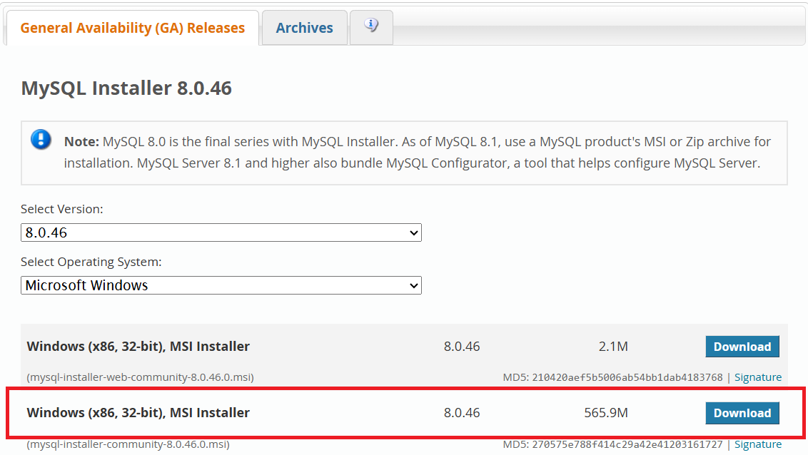
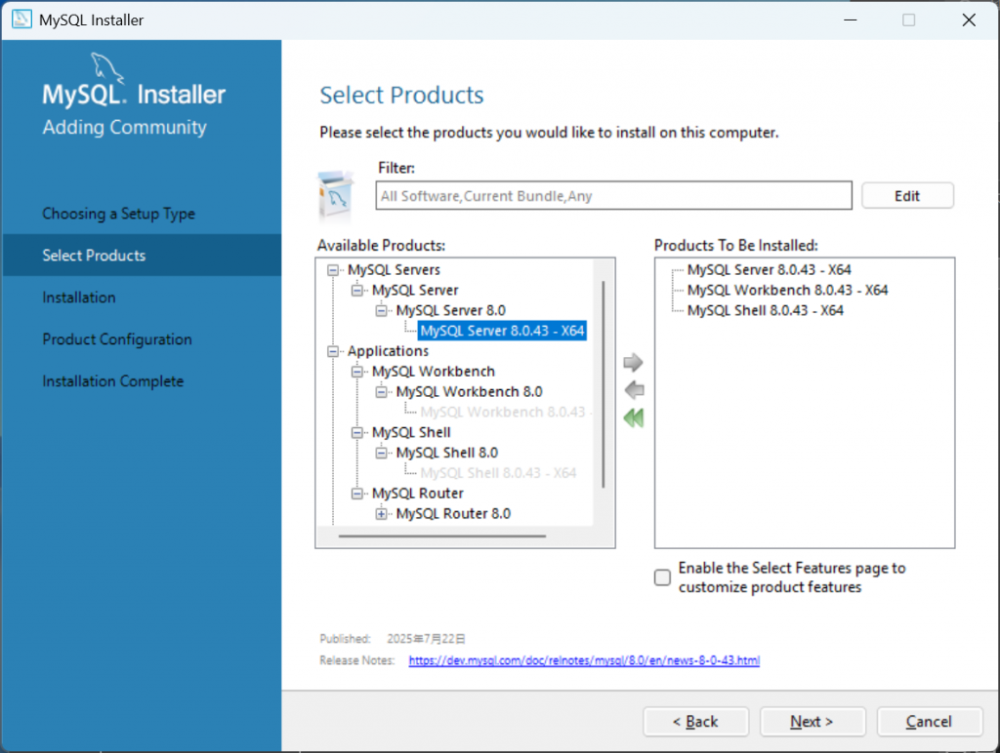
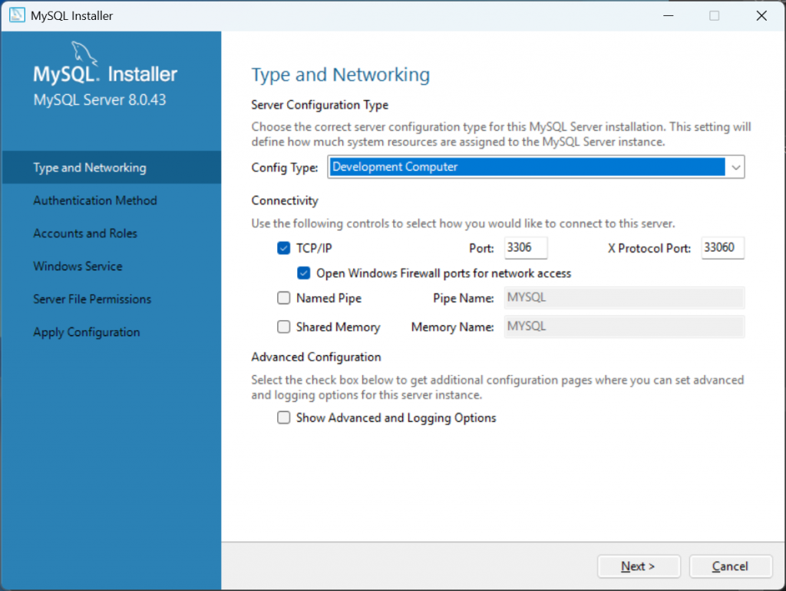
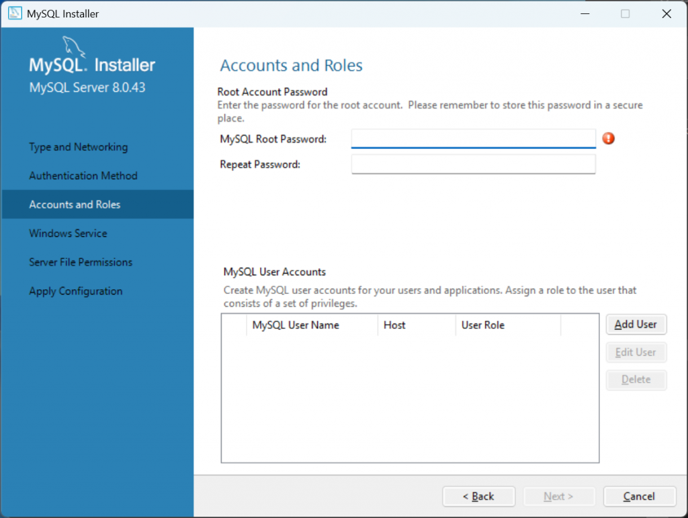
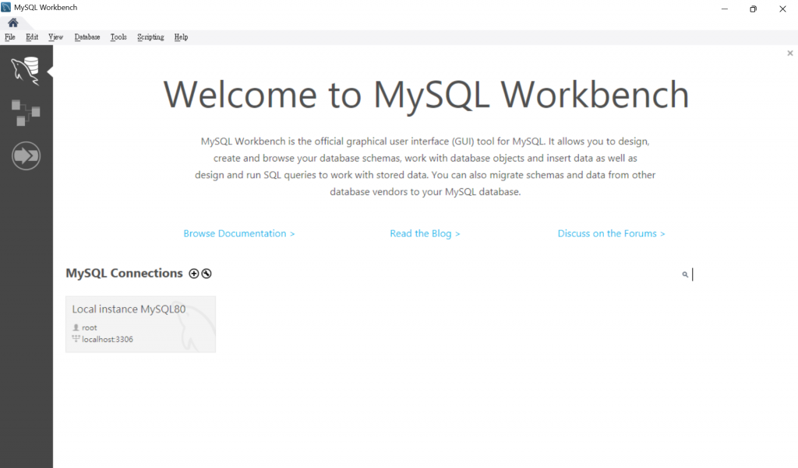
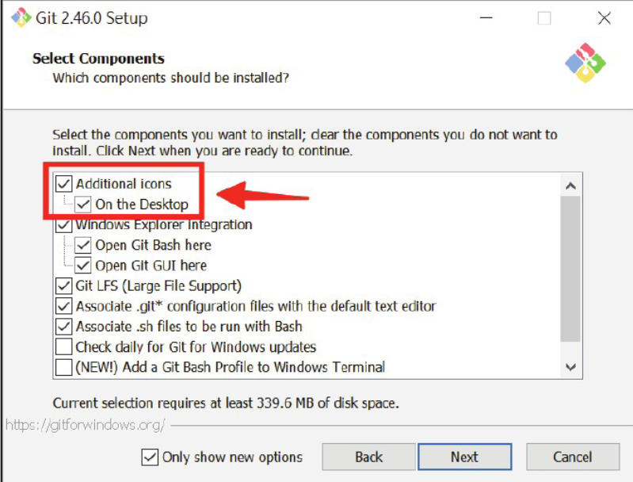
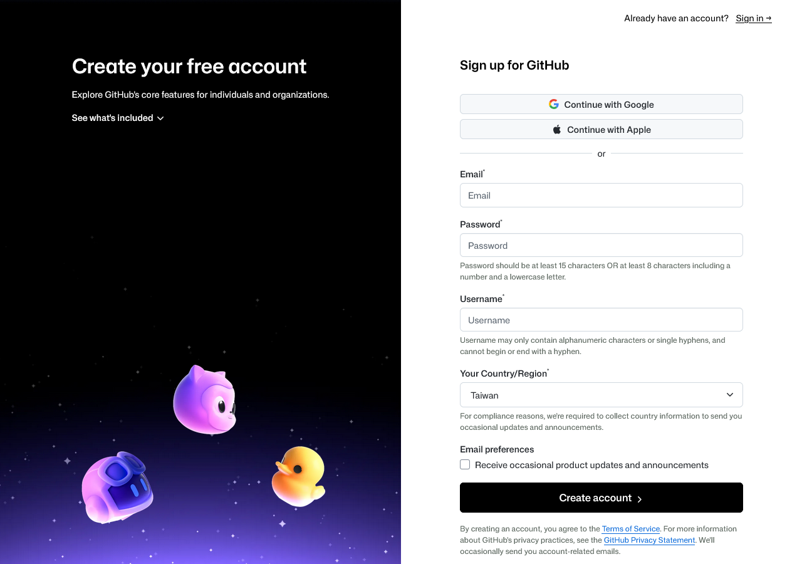
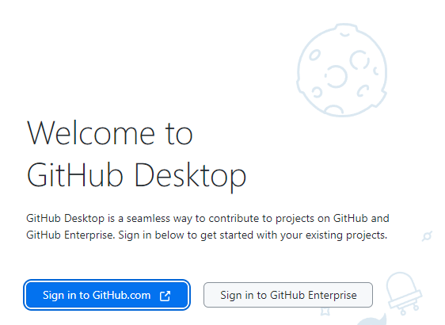
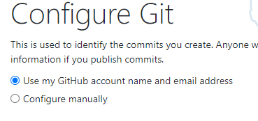
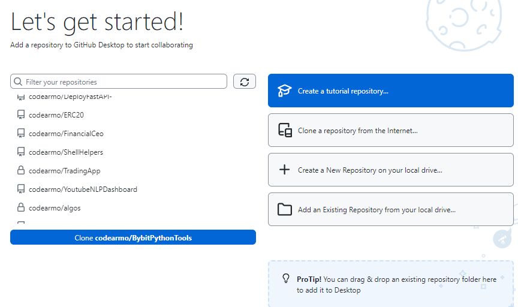

<div class="flex flex-col justify-center items-center h-full" style="background: #ffffff;">
  <p style="color: #5eada0; font-size: 1rem; font-weight: 600; letter-spacing: 0.2em; text-transform: uppercase; margin-bottom: 1.2rem;">
    Spring Boot Backend Masterclass
  </p>
  <h1 style="color: #1a5c5c; font-size: 3.8rem; font-weight: 900; line-height: 1.15; margin-bottom: 1.5rem;">
    環境安裝
  </h1>
  <div style="height: 4px; width: 320px; background: linear-gradient(90deg, #5eada0, #a7d9d0); border-radius: 2px; margin-bottom: 1.5rem;"></div>
  <p style="color: #4a7c7c; font-size: 1.15rem; font-style: italic;">
    「工欲善其事，必先利其器」
  </p>
  <Link to="home" style="color: #9dc4c4; font-size: 0.85rem; margin-top: 2rem; text-decoration: none; letter-spacing: 0.05em;">← 返回目錄</Link>
</div>

<!--
大家好，歡迎來到第二章。

上一章我們認識了 Spring Boot：它就像便利商店，讓小明不用自己買印表機，專心寫作業就好。

不過在開始寫程式之前，還是要先把文具準備好。今天要在電腦上裝好六樣工具。每一樣工具，我們都先用小明的故事說明它是做什麼的，再一步一步安裝。
-->

---

# 今天要準備的六樣工具

<v-clicks>

- **JDK**：讓電腦看得懂 Java
- **Eclipse**：寫程式的書桌
- **MySQL**：存放資料的檔案櫃
- **Git**：替作業留下每一次的存檔點
- **GitHub**：放在雲端的作業簿
- **GitHub Desktop**：用按鈕操作 Git 的工具

</v-clicks>

<!--
今天要準備六樣工具。

（下一步）JDK，讓電腦看得懂 Java。

（下一步）Eclipse，寫程式的書桌。

（下一步）MySQL，存放資料的檔案櫃。

（下一步）Git，替作業留下每一次的存檔點。

（下一步）GitHub，放在雲端的作業簿。

（下一步）GitHub Desktop，用按鈕操作 Git 的工具。

裝的東西比較多，但每一樣都只要裝一次。今天裝好，之後整門課都會用到。
-->

---
layout: section
class: flex flex-col justify-center items-center text-center
---

# Part 1
# 小明開學前準備文具

<!--
先用小明的故事，看這六樣工具各是什麼。
-->

---

# 開學前，小明要準備什麼

<v-clicks>

- 一張**書桌**，在上面寫作業
- 寫作業要用的**語言**：老師出的是英文作業，小明得先會英文
- 一個**檔案櫃**，把寫好的資料收好
- 每寫完一段就**存檔一次**，寫壞了可以回到上一版
- 一本**雲端作業簿**：電腦壞了也不怕，還能和同學一起寫
- 存檔太麻煩？用一個**有按鈕的小幫手**來做

</v-clicks>

<!--
開學前，小明要準備哪些東西？

（下一步）一張書桌，在上面寫作業。

（下一步）寫作業要用的語言。老師出的是英文作業，小明得先會英文，才看得懂題目、寫得出答案。

（下一步）一個檔案櫃，把寫好的資料收好。

（下一步）每寫完一段就存檔一次。寫壞了，可以回到上一版。

（下一步）一本雲端作業簿。電腦壞了也不怕，資料還在。而且可以和同學一起寫。

（下一步）每次存檔都要做好幾個步驟，有點麻煩。所以找一個有按鈕的小幫手，按一下就存好。
-->

---

# 對照到程式的工具

<Pairs left="小明的文具" right="工具" rows="book,寫作業的語言=code,JDK：讓電腦看得懂 Java|shop,書桌=code,Eclipse：寫程式的地方|cabinet,檔案櫃=server,MySQL：資料庫|doc,每一段的存檔點=code,Git：版本控制|browser,雲端作業簿=browser,GitHub：放程式的雲端網站|ok,有按鈕的小幫手=code,GitHub Desktop：Git 的按鈕版" />

<!--
對照到程式的工具。

（下一步）寫作業的語言，是 JDK。我們用 Java 寫程式，電腦要先裝 JDK，才看得懂 Java。

（下一步）書桌，是 Eclipse。我們在這裡寫程式、執行程式。

（下一步）檔案櫃，是 MySQL，一種資料庫。

（下一步）每一段的存檔點，是 Git。正式的名字叫版本控制。

（下一步）雲端作業簿，是 GitHub，一個放程式的網站。

（下一步）有按鈕的小幫手，是 GitHub Desktop。
-->

---

# 想一想

<Poll question="小明寫程式寫到一半，改壞了，想回到昨天的樣子。要靠哪一樣工具？" options="MySQL|Git|Eclipse|JDK" answer="2" />

<!--
來想一題。

小明寫程式寫到一半，改壞了，想回到昨天的樣子。要靠哪一樣工具？

（等大家作答）

（下一步）答案是 Git。

Git 會替每一次存檔留下一個存檔點。只要昨天有存過，就能回到昨天的版本。MySQL 存的是程式用的資料，不是程式本身。
-->

---
layout: section
class: flex flex-col justify-center items-center text-center
---

# Part 2
# JDK：讓電腦看得懂 Java

<!--
第一樣，JDK。
-->

---

# JDK 是什麼

<v-clicks>

- 我們寫的 Java 程式，電腦**不能直接看懂**
- **JDK**（Java Development Kit）：寫 Java 需要的整套工具，包含把程式翻成電腦看得懂的樣子、以及執行它
- 這門課用 **Java 21**：它是長期支援版（LTS），會維護很多年；Spring Boot 4 最低要求 17，我們直接用更新的 21

</v-clicks>

<v-click>

<div class="mt-4 p-3 bg-blue-50 border-l-4 border-blue-400 text-gray-700 text-left">
💡 JDK 有很多家公司在做，內容幾乎一樣。這門課用免費的 <b>Eclipse Temurin</b>，到 <code>adoptium.net</code> 下載。
</div>

</v-click>

<!--
JDK 是什麼？

（下一步）我們寫的 Java 程式，電腦不能直接看懂。就像英文作業，小明要先學會英文。

（下一步）JDK，全名是 Java Development Kit，Java 開發工具包。它是寫 Java 需要的整套工具。其中最重要的兩件事：把我們寫的程式翻成電腦看得懂的樣子，以及執行它。

（下一步）這門課用 Java 21。它是長期支援版，英文縮寫 LTS，會維護很多年。我們用的 Spring Boot 4 最低要求是 Java 17，我們直接用更新的 21。

（下一步）JDK 有很多家公司在做，內容幾乎一樣。這門課用免費的 Eclipse Temurin，到 adoptium.net 下載。注意它和等一下要裝的 Eclipse 書桌是兩樣東西，只是名字很像。
-->

---

# 安裝 JDK 21

<v-clicks>

1. 前往 `adoptium.net`，點選上方的 **Temurin**，再點 **Other platforms and versions**
2. 作業系統選 **Windows**、架構選 **x64**、版本選 **21 - LTS**，下載 **.msi**
3. 執行安裝程式。在選擇功能的畫面，把 **Set JAVA_HOME variable** 改成「安裝在本機」
4. 其他保持預設，一路按 **Next**，最後按 **Install**

</v-clicks>

<v-click>

開啟命令提示字元（`Win + R`，輸入 `cmd`），輸入：

```bash
java -version
```

看到 `openjdk version "21.0.…"` 就是裝好了。

</v-click>

<!--
安裝 JDK 21。這一段沒有截圖，請照著文字一步一步做。

（下一步）第一步，前往 adoptium.net。首頁會推薦最新的版本，我們要的不是最新版，所以點上方的 Temurin，再點 Other platforms and versions，其他平台和版本。

（下一步）第二步，作業系統選 Windows，架構選 x64，版本選 21 - LTS。下載副檔名是 msi 的安裝檔。

（下一步）第三步，執行安裝程式。中間有一個選擇功能的畫面，其中有一項叫 Set JAVA_HOME variable，預設是不安裝的。請點它，改成「安裝在本機」。JAVA_HOME 是一個系統設定，告訴其他程式 JDK 裝在哪裡，第三章建立專案的時候會用到。

（下一步）其他保持預設，一路按 Next，最後按 Install。

（下一步）裝好之後確認一下。按 Win 加 R，輸入 cmd，開啟命令提示字元。輸入 java 空格 減號 version。

看到 openjdk version 21 開頭，就是裝好了。如果說找不到 java 這個指令，請把命令提示字元關掉重開一次，新的設定才會生效。
-->

---
layout: section
class: flex flex-col justify-center items-center text-center
---

# Part 3
# Eclipse：寫程式的書桌

<!--
第二樣，Eclipse。
-->

---

# Eclipse 是什麼

<v-clicks>

- 寫程式可以用記事本，但是很辛苦：打錯字沒人提醒，要執行還得自己打指令
- **Eclipse** 是一種 **IDE**（整合開發環境）：寫程式、找錯誤、執行，都在同一個視窗裡
- 就像一張整理好的書桌：文具都在手邊，寫錯了旁邊有人提醒

</v-clicks>

<v-click>

<div class="mt-4 p-3 bg-blue-50 border-l-4 border-blue-400 text-gray-700 text-left">
💡 Eclipse 有很多種版本。請選 <b>Eclipse IDE for Enterprise Java and Web Developers</b>：它已經內建 Gradle 的支援，第三章匯入專案時會用到。
</div>

</v-click>

<!--
Eclipse 是什麼？

（下一步）寫程式其實可以用記事本。但是很辛苦：打錯字沒有人提醒，要執行程式還得自己打指令。

（下一步）Eclipse 是一種 IDE，中文叫整合開發環境。寫程式、找錯誤、執行，都在同一個視窗裡完成。

（下一步）就像一張整理好的書桌。文具都在手邊，寫錯了旁邊有人提醒。打錯字的地方，Eclipse 會畫紅線。

（下一步）Eclipse 有很多種版本。請選 Eclipse IDE for Enterprise Java and Web Developers。它已經內建 Gradle 的支援，第三章匯入專案的時候會用到。Gradle 是什麼，第三章再說。
-->

---

# 安裝 Eclipse

<v-clicks>

1. 前往 `eclipse.org/downloads`，下載 **Eclipse Installer**
2. 執行後，在清單裡選 **Eclipse IDE for Enterprise Java and Web Developers**
3. **Java VM** 選剛才裝好的 JDK 21；安裝位置保持預設，按 **INSTALL**
4. 裝好後按 **LAUNCH**，第一次開啟會問 **Workspace**（放專案的資料夾）

</v-clicks>

<v-click>

<div class="mt-4 p-3 bg-yellow-50 border-l-4 border-yellow-400 text-gray-700 text-left">
⚠️ Workspace 的路徑<b>不要有中文或空格</b>，例如用 <code>C:\workspace</code>。路徑有中文，之後建構專案很容易失敗。
</div>

</v-click>

<!--
安裝 Eclipse。這一段也沒有截圖，請照著文字做。

（下一步）第一步，前往 eclipse.org/downloads，下載 Eclipse Installer，Eclipse 的安裝程式。

（下一步）第二步，執行之後會出現一份清單，選 Eclipse IDE for Enterprise Java and Web Developers。

（下一步）第三步，Java VM 這一欄，選剛才裝好的 JDK 21。安裝位置保持預設，按 INSTALL。中間會問是否接受授權條款，按接受。

（下一步）第四步，裝好之後按 LAUNCH 開啟。第一次開啟會問 Workspace，意思是放專案的資料夾。

（下一步）Workspace 的路徑不要有中文或空格。例如直接用 C 槽底下的 workspace。路徑有中文的話，之後建構專案很容易失敗，而且錯誤訊息很難看懂。

打開之後會看到一個歡迎畫面，關掉它，就是我們的書桌了。
-->

---
layout: section
class: flex flex-col justify-center items-center text-center
---

# Part 4
# MySQL：存放資料的檔案櫃

<!--
第三樣，MySQL。
-->

---

# MySQL 是什麼

<v-clicks>

- 程式關掉之後，記在程式裡的東西就不見了
- 要長期保存的資料（學生名單、訂單、問卷），要放進**資料庫**
- **MySQL** 是最常見的資料庫之一，免費；**MySQL Workbench** 是它的操作畫面

</v-clicks>

<v-click>

<div class="mt-4 p-3 bg-blue-50 border-l-4 border-blue-400 text-gray-700 text-left">
💡 第二十二章開始會一直用到它。現在只要裝好、記住 <b>root 密碼</b>就可以。
</div>

</v-click>

<!--
MySQL 是什麼？

（下一步）程式關掉之後，記在程式裡的東西就不見了。就像寫在白板上的字，下課就被擦掉。

（下一步）要長期保存的資料，例如學生名單、訂單、問卷，要放進資料庫。就像收進檔案櫃。

（下一步）MySQL 是最常見的資料庫之一，而且免費。MySQL Workbench 是它的操作畫面，讓我們可以打開檔案櫃看看裡面有什麼。

（下一步）第二十二章開始會一直用到它。現在只要裝好，並且記住等一下設定的 root 密碼就可以了。
-->

---

# 安裝 MySQL（一）：下載

前往 `dev.mysql.com/downloads/installer/`，下載下方 **Full Bundle** 的版本。



<v-click>

<div class="mt-4 p-3 bg-blue-50 border-l-4 border-blue-400 text-gray-700 text-left">
💡 下載前會請你登入 Oracle 帳號，點下方的「No thanks, just start my download.」就可以跳過。
</div>

</v-click>

<!--
前往 dev.mysql.com/downloads/installer，下載下方比較大的那一個，Full Bundle 的版本。

（下一步）按下載之後，會請你登入 Oracle 帳號。不用登入，點下方的「No thanks, just start my download.」就可以直接下載。
-->

---

# 安裝 MySQL（二）：選擇要裝的元件

<v-clicks>

1. 執行下載的安裝程式，Setup Type 選 **Server only**
2. 在 **Select Products** 畫面，從左邊把 **MySQL Workbench** 和 **MySQL Shell** 加到右邊
3. 按 **Next**，再按 **Execute** 開始安裝

</v-clicks>



<!--
執行下載的安裝程式。

（下一步）Setup Type 選 Server only。

（下一步）只裝 Server 不夠，我們還需要操作畫面。在 Select Products 這個畫面，就是下面這張圖，從左邊的清單找到 MySQL Workbench 和 MySQL Shell，加到右邊。右邊最後應該有三樣：Server、Workbench、Shell。

（下一步）按 Next，再按 Execute，等它安裝完成。
-->

---

# 安裝 MySQL（三）：設定伺服器

接著會進入設定精靈，前面幾頁**保持預設**：

<v-clicks>

- Config Type：**Development Computer**（開發用，佔用記憶體比較少）
- Port：**3306**（MySQL 的門牌號碼，不要改）
- Authentication：保持預設

</v-clicks>



<!--
安裝完成後，會進入設定精靈。前面幾頁都保持預設就好。

（下一步）Config Type 是 Development Computer，開發用的電腦，佔用的記憶體比較少。

（下一步）Port 是 3306。Port 可以想成門牌號碼，程式要找 MySQL，就去敲 3306 這扇門。請不要改，之後的設定都會用這個號碼。

（下一步）Authentication 驗證方式，保持預設。
-->

---

# 安裝 MySQL（四）：設定 root 密碼

**最重要的一步**：替最高權限的帳號 `root` 設定密碼。



<v-click>

<div class="mt-4 p-3 bg-yellow-50 border-l-4 border-yellow-400 text-gray-700 text-left">
⚠️ 這個密碼<b>一定要記下來</b>。之後 Spring Boot 連資料庫、用 Workbench 開資料庫都要用它。忘了的話，處理起來很麻煩。
</div>

</v-click>

<!--
接下來是最重要的一步：替 root 這個帳號設定密碼。root 是 MySQL 裡權限最高的帳號，什麼都能做。

在 MySQL Root Password 輸入密碼，Repeat Password 再輸入一次。

（下一步）這個密碼一定要記下來。之後 Spring Boot 連資料庫、用 Workbench 開資料庫，都要用它。忘了的話，要重設很麻煩。上課練習的話，可以用簡單好記的密碼，但是請不要和你其他重要帳號的密碼一樣。
-->

---

# 安裝 MySQL（五）：完成並確認

<v-clicks>

1. Windows Service 的頁面保持預設：服務名稱 `MySQL80`、**開機自動啟動**
2. 按 **Execute** 套用設定，最後按 **Finish**
3. 開啟 **MySQL Workbench**，點 **Local instance MySQL80**，輸入 root 密碼

</v-clicks>



<!--
最後幾步。

（下一步）Windows Service 的頁面保持預設。服務名稱是 MySQL80，勾選開機自動啟動。這樣每次開機，MySQL 就會自己開始運作，不用手動打開。

（下一步）按 Execute 套用所有設定，全部打勾之後，按 Finish。

（下一步）確認一下。開啟 MySQL Workbench，主畫面上有一張卡片叫 Local instance MySQL80。點它，輸入剛才的 root 密碼。能進去，就代表檔案櫃裝好了。
-->

---
layout: section
class: flex flex-col justify-center items-center text-center
---

# Part 5
# Git：作業的存檔點

<!--
第四樣，Git。
-->

---

# Git 是什麼

<v-clicks>

- 沒有 Git：`作業.docx`、`作業_改.docx`、`作業_最終版.docx`、`作業_真的最終版.docx`……
- **Git** 替每一次修改留下一個**存檔點**，記下「改了什麼、誰改的、什麼時候」
- 改壞了，可以回到任何一個存檔點；檔案永遠只有一份

</v-clicks>

<v-click>

<div class="mt-4 p-3 bg-blue-50 border-l-4 border-blue-400 text-gray-700 text-left">
💡 這種工具叫做<b>版本控制</b>。幾乎所有公司寫程式都會用它。存檔點在 Git 裡叫做 <b>commit</b>。
</div>

</v-click>

<!--
Git 是什麼？

（下一步）沒有 Git 的時候，我們怎麼保留舊版本？常常是這樣：作業點 docx，作業改，作業最終版，作業真的最終版。過一陣子，自己都分不清哪一個才是對的。

（下一步）Git 會替每一次修改留下一個存檔點。記下改了什麼、誰改的、什麼時候改的。

（下一步）改壞了，可以回到任何一個存檔點。而且資料夾裡的檔案永遠只有一份，不會多出一堆副本。

（下一步）這種工具叫做版本控制。幾乎所有公司寫程式都會用它。存檔點在 Git 裡有一個正式的名字，叫做 commit。
-->

---

# 安裝 Git

<v-clicks>

1. 前往 `git-scm.com/downloads`，點 **Windows**，再點 **Click here to download**
2. 執行安裝程式，按幾次 **Next**
3. 到 **Select Components** 時，勾選 **Additional icons → On the Desktop**
4. 其他保持預設，按 **Next** 直到完成

</v-clicks>



<!--
安裝 Git。

（下一步）前往 git-scm.com/downloads，點 Windows，再點 Click here to download 開始下載。

（下一步）執行安裝程式，按幾次 Next。

（下一步）到 Select Components 這個畫面，就是下面這張圖，勾選左上角的 Additional icons 底下的 On the Desktop。這樣桌面會多一個 Git Bash 的圖示。

（下一步）其他的選項很多，全部保持預設，一路按 Next 直到完成。
-->

---

# 確認 Git 裝好了

開啟命令提示字元，輸入：

```bash
git --version
```

<v-click>

看到版本號就是裝好了：

```text
git version 2.49.0.windows.1
```

</v-click>

<!--
確認 Git 裝好了。和剛才確認 JDK 一樣，開啟命令提示字元，輸入 git 空格 減號減號 version。

（下一步）看到版本號，就是裝好了。版本號和畫面上的不一樣沒關係，有數字出現就好。
-->

---
layout: section
class: flex flex-col justify-center items-center text-center
---

# Part 6
# GitHub：雲端的作業簿

<!--
第五樣，GitHub。
-->

---

# GitHub 是什麼

<Pairs left="Git" right="GitHub" sign="vs" rows="code,一個軟體，裝在自己的電腦=browser,一個網站，在雲端|doc,替作業留存檔點=browser,把存檔點連同作業放到雲端|you,自己一個人用就可以=customer,可以分享、和別人一起改" />

<v-click>

<div class="mt-4 p-3 bg-blue-50 border-l-4 border-blue-400 text-gray-700 text-left">
💡 只有 Git，電腦壞了存檔點也跟著不見。把作業放上 GitHub，換一台電腦也拿得回來。放程式的地方叫做 <b>repository</b>（儲存庫，常簡稱 repo）。
</div>

</v-click>

<!--
GitHub 是什麼？它和 Git 名字很像，但是兩樣東西。

（下一步）Git 是一個軟體，裝在自己的電腦。GitHub 是一個網站，在雲端。

（下一步）Git 替作業留存檔點。GitHub 把這些存檔點，連同作業一起放到雲端。

（下一步）Git 自己一個人用就可以。GitHub 可以分享給別人，也可以和別人一起改。

（下一步）只有 Git 的話，電腦壞了，存檔點也跟著不見。把作業放上 GitHub，換一台電腦也拿得回來。GitHub 上放程式的地方，叫做 repository，中文是儲存庫，常常簡稱 repo。
-->

---

# 想一想

<Poll question="下面哪一句話是對的？" options="Git 是網站，GitHub 是軟體|Git 記錄存檔點，GitHub 把它們放到雲端|有了 GitHub 就不用裝 Git|GitHub 是資料庫" answer="2" />

<!--
來想一題。下面哪一句話是對的？

（等大家作答）

（下一步）答案是：Git 記錄存檔點，GitHub 把它們放到雲端。

第一個選項剛好相反。第三個也不對，存檔點是在自己電腦上用 Git 做的，GitHub 只是雲端的存放處。GitHub 也不是資料庫，存放資料的是 MySQL。
-->

---

# 註冊 GitHub 帳號

<div class="grid grid-cols-2 gap-6">
<div>

<v-clicks>

1. 前往 `github.com`，點右上角 **Sign up**
2. 填 Email、密碼、**Username**
3. 完成拼圖驗證
4. 到信箱收驗證碼，輸入後啟用帳號
5. 方案選 **Free** 就夠用

</v-clicks>

</div>
<div>



</div>
</div>

<v-click>

<div class="mt-4 p-3 bg-yellow-50 border-l-4 border-yellow-400 text-gray-700 text-left">
⚠️ Username 會出現在你所有程式的網址裡，例如 <code>github.com/你的名字</code>。請用英文，選一個正式一點的名字。
</div>

</v-click>

<!--
註冊 GitHub 帳號。

（下一步）前往 github.com，點右上角的 Sign up。

（下一步）填 Email、密碼，以及 Username，也就是帳號名稱。

（下一步）完成拼圖驗證，證明你不是機器人。

（下一步）到信箱收驗證信，把裡面的驗證碼輸入進去，帳號就啟用了。

（下一步）最後選方案，選 Free 免費的就夠用。

（下一步）提醒一下 Username。它會出現在你所有程式的網址裡。以後找工作的時候，可能會把 GitHub 給別人看，所以請用英文，選一個正式一點的名字。
-->

---
layout: section
class: flex flex-col justify-center items-center text-center
---

# Part 7
# GitHub Desktop：按鈕版的 Git

<!--
最後一樣，GitHub Desktop。
-->

---

# 為什麼要 GitHub Desktop

<v-clicks>

- Git 原本要在命令提示字元**打指令**操作，初學的時候很容易打錯
- **GitHub Desktop** 把常用的動作做成按鈕：看改了什麼、建立存檔點、上傳到 GitHub
- 背後做的事和打指令一模一樣，只是換成按鈕

</v-clicks>

<!--
為什麼還要 GitHub Desktop？

（下一步）Git 原本要在命令提示字元打指令操作。初學的時候，指令很容易打錯，也看不出現在的狀態。

（下一步）GitHub Desktop 把常用的動作做成按鈕。看看改了什麼、建立存檔點、上傳到 GitHub，都是按一下就好。

（下一步）背後做的事和打指令一模一樣，只是換成按鈕。這門課用它來操作 Git。
-->

---

# 安裝與登入

<div class="grid grid-cols-2 gap-6">
<div>

<v-clicks>

1. 前往 `desktop.github.com`，下載 Windows 版
2. 執行安裝檔，**全自動**安裝，不用按任何按鈕
3. 自動開啟後，點 **Sign in to GitHub.com**，用剛才的帳號登入

</v-clicks>

</div>
<div>



</div>
</div>

<!--
安裝和登入。

（下一步）前往 desktop.github.com，下載 Windows 版。

（下一步）執行安裝檔。它是全自動安裝的，不用按任何按鈕，通常不到一分鐘。

（下一步）裝好之後會自動開啟，出現這個歡迎畫面。點 Sign in to GitHub.com，瀏覽器會跳出來，用剛才註冊的帳號登入，再回到 GitHub Desktop。
-->

---

# 設定 Git 的身分

<v-clicks>

- **Name**：每一個存檔點上顯示的名字
- **Email**：請填**和 GitHub 帳號相同**的 Email
- 按 **Finish** 完成

</v-clicks>



<v-click>

<div class="mt-4 p-3 bg-blue-50 border-l-4 border-blue-400 text-gray-700 text-left">
💡 每一個存檔點都會記下「誰做的」。Email 和 GitHub 相同，GitHub 才認得出那些存檔點是你的。
</div>

</v-click>

<!--
登入之後，要設定 Git 的身分。

（下一步）Name，每一個存檔點上顯示的名字。

（下一步）Email，請填和 GitHub 帳號相同的 Email。

（下一步）按 Finish 完成。

（下一步）為什麼要設定？因為每一個存檔點都會記下是誰做的。Email 和 GitHub 帳號相同，GitHub 才認得出這些存檔點是你的。
-->

---

# 全部裝好了嗎



<v-clicks>

- ✅ `java -version` 顯示 21
- ✅ Eclipse 打得開，Workspace 路徑沒有中文
- ✅ MySQL Workbench 用 root 密碼連得進去
- ✅ `git --version` 有版本號
- ✅ GitHub Desktop 已經登入

</v-clicks>

<!--
看到 GitHub Desktop 的主畫面，六樣工具就全部裝好了。我們用一份清單確認一次。

（下一步）java 減號 version 顯示 21。

（下一步）Eclipse 打得開，Workspace 路徑沒有中文。

（下一步）MySQL Workbench 用 root 密碼連得進去。

（下一步）git 減號減號 version 有版本號。

（下一步）GitHub Desktop 已經登入。

有任何一項沒過，請回到那一部分重新看一次，或是在課堂上提出來。
-->

---

# 複習：小明的文具

<Pairs left="小明的文具" right="工具" rows="book,寫作業的語言=code,JDK 21（Eclipse Temurin）|shop,書桌=code,Eclipse（Enterprise Java 版）|cabinet,檔案櫃=server,MySQL + Workbench（記住 root 密碼）|doc,每一段的存檔點=code,Git（commit）|browser,雲端作業簿=browser,GitHub（repository）|ok,有按鈕的小幫手=code,GitHub Desktop" />

<!--
我們用一張圖複習今天的內容。

（下一步）寫作業的語言，是 JDK 21，我們用 Eclipse Temurin。

（下一步）書桌，是 Eclipse，選 Enterprise Java 的版本。

（下一步）檔案櫃，是 MySQL 和 Workbench。記住 root 密碼。

（下一步）每一段的存檔點，是 Git，存檔點叫 commit。

（下一步）雲端作業簿，是 GitHub，放程式的地方叫 repository。

（下一步）有按鈕的小幫手，是 GitHub Desktop。
-->

---

# 章節總結

<v-clicks>

- **JDK 21**：讓電腦看得懂 Java；安裝時記得設定 `JAVA_HOME`
- **Eclipse**：寫程式的 IDE；Workspace 路徑不要有中文或空格
- **MySQL**：資料庫，Port 3306；root 密碼一定要記住
- **Git**：版本控制，每個存檔點叫 commit；**GitHub**：把它們放到雲端
- **GitHub Desktop**：Git 的按鈕版，Email 要和 GitHub 相同

</v-clicks>

<v-click>

下一章：在書桌上建立第一個 Spring Boot 專案，讓瀏覽器顯示 Hello World。

</v-click>

<!--
最後整理今天的重點。

（依序按下一步）JDK 21 讓電腦看得懂 Java，安裝時記得設定 JAVA_HOME。Eclipse 是寫程式的 IDE，Workspace 路徑不要有中文或空格。MySQL 是資料庫，Port 是 3306，root 密碼一定要記住。Git 是版本控制，每個存檔點叫 commit；GitHub 把它們放到雲端。GitHub Desktop 是 Git 的按鈕版，Email 要和 GitHub 相同。

（最後一步）下一章，我們就在這張書桌上建立第一個 Spring Boot 專案，讓瀏覽器顯示 Hello World。
-->

---
layout: end
---

# Q & A

有任何安裝問題嗎？

<!--
今天的內容到這邊。

安裝的過程中遇到任何問題，都歡迎提出來。
-->
