<div class="flex flex-col justify-center items-center h-full" style="background: #ffffff;">
  <p style="color: #5eada0; font-size: 1rem; font-weight: 600; letter-spacing: 0.2em; text-transform: uppercase; margin-bottom: 1.2rem;">
    Spring Boot Backend Masterclass
  </p>
  <h1 style="color: #1a5c5c; font-size: 3.8rem; font-weight: 900; line-height: 1.15; margin-bottom: 1.5rem;">
    第一個 Spring Boot 程式
  </h1>
  <div style="height: 4px; width: 320px; background: linear-gradient(90deg, #5eada0, #a7d9d0); border-radius: 2px; margin-bottom: 1.5rem;"></div>
  <p style="color: #4a7c7c; font-size: 1.15rem; font-style: italic;">
    「從零到第一個 Hello World，只需要幾分鐘」
  </p>
  <Link to="home" style="color: #9dc4c4; font-size: 0.85rem; margin-top: 2rem; text-decoration: none; letter-spacing: 0.05em;">← 返回目錄</Link>
</div>

<!--
大家好，歡迎來到第三章。

上一章把工具都裝好了。今天要在 Eclipse 這張書桌上，建立第一個 Spring Boot 專案，寫一小段程式，讓瀏覽器顯示 Hello World。

就像小明第一次走進便利商店印作業。我們先不追究機器裡面怎麼運作，先把整個流程走一遍，看到結果。
-->

---

# 今天要完成的三件事

<v-clicks>

- **建立專案**：用 Spring Initializr 拿到一個配好的專案
- **搬上書桌**：把專案匯入 Eclipse
- **寫一個櫃台、按下執行**：寫 `MyController`，在瀏覽器看到 Hello World

</v-clicks>

<!--
今天要完成三件事。

（下一步）第一，建立專案。用一個叫 Spring Initializr 的網站，拿到一個配好的專案。

（下一步）第二，把專案匯入 Eclipse，搬上書桌。

（下一步）第三，寫一個櫃台，也就是 MyController。按下執行，在瀏覽器看到 Hello World。
-->

---
layout: section
class: flex flex-col justify-center items-center text-center
---

# Part 1
# 小明第一次到便利商店

<!--
先看小明的故事。
-->

---

# 第一次去便利商店印作業

<v-clicks>

- 店員遞給小明一個**配好的工具箱**：需要的東西都在裡面，不用自己一樣一樣買
- 小明把工具箱**搬上書桌**，打開來看看
- 櫃台有一位**店員**，專門負責「印作業」這件事
- 小明**按下列印鈕**，機器動起來，作業印出來了

</v-clicks>

<!--
小明第一次去便利商店印作業。

（下一步）店員遞給他一個配好的工具箱。印作業需要的東西都在裡面，不用自己一樣一樣去買。

（下一步）小明把工具箱搬上書桌，打開來看看裡面有什麼。

（下一步）櫃台有一位店員，專門負責「印作業」這件事。有人說要印作業，就由他處理。

（下一步）小明按下列印鈕，機器動起來，作業印出來了。

今天要做的四件事，剛好就是這四步。
-->

---

# 對照到今天的步驟

<Pairs left="便利商店" right="今天的步驟" rows="backpack,配好的工具箱=code,Spring Initializr 產生的專案|shop,搬上書桌=code,匯入 Eclipse|clerk,負責印作業的店員=code,MyController（負責 /test 這個網址）|printer,按下列印鈕=code,執行程式，打開 localhost:8080/test" />

<!--
對照到今天的步驟。

（下一步）配好的工具箱，是 Spring Initializr 產生的專案。

（下一步）搬上書桌，是匯入 Eclipse。

（下一步）負責印作業的店員，是我們要寫的 MyController。它負責 /test 這個網址。

（下一步）按下列印鈕，是執行程式，然後在瀏覽器打開 localhost:8080/test。
-->

---

# 想一想

<Poll question="Spring Initializr 最像便利商店裡的哪一樣東西？" options="櫃台店員|配好的工具箱|列印鈕|印出來的作業" answer="2" />

<!--
來想一題。Spring Initializr 最像便利商店裡的哪一樣東西？

（等大家作答）

（下一步）答案是配好的工具箱。

它幫我們把一個 Spring Boot 專案需要的檔案和設定都準備好，打包成一個壓縮檔。我們不用從零開始一個一個建。
-->

---
layout: section
class: flex flex-col justify-center items-center text-center
---

# Part 2
# 拿到配好的工具箱

<!--
第一步，用 Spring Initializr 建立專案。
-->

---

# Spring Initializr 是什麼

<v-clicks>

- 一個 Spring Boot 專案需要很多檔案：設定檔、資料夾、啟動程式、建構工具……
- **Spring Initializr**（`start.spring.io`）：勾一勾選項，就產生一個配好的專案，下載回來是一個 zip
- 專案用 **Gradle** 管理：它會照設定檔，自動下載專案需要的套件

</v-clicks>

<v-click>

<div class="mt-4 p-3 bg-blue-50 border-l-4 border-blue-400 text-gray-700 text-left">
💡 <b>套件</b>（在 Gradle 裡叫<b>依賴</b>，dependency）：別人寫好、可以直接拿來用的程式。例如今天要加的 Spring Web，就是一個讓我們能寫網站的套件。
</div>

</v-click>

<!--
Spring Initializr 是什麼？

（下一步）一個 Spring Boot 專案需要很多檔案。設定檔、資料夾、啟動程式、建構工具等等。自己一個一個建，很容易漏掉。

（下一步）Spring Initializr，網址是 start.spring.io。勾一勾選項，它就產生一個配好的專案，下載回來是一個 zip 壓縮檔。

（下一步）產生的專案用 Gradle 來管理。Gradle 是一個建構工具，它會照設定檔，自動下載專案需要的套件。

（下一步）套件，在 Gradle 裡叫做依賴，英文是 dependency。它是別人寫好、可以直接拿來用的程式。今天要加的 Spring Web，就是一個讓我們能寫網站的套件。
-->

---

# 填寫專案設定

<div class="grid grid-cols-2 gap-6">
<div>

前往 `start.spring.io`：

<v-clicks>

- Project：**Gradle - Groovy**
- Language：**Java**
- Spring Boot：**保持預設**（4 開頭，不要選有 SNAPSHOT、RC、M 的）
- Group：`com.example`，Artifact：`demo`
- Packaging：**Jar**，Java：**21**

</v-clicks>

</div>
<div>

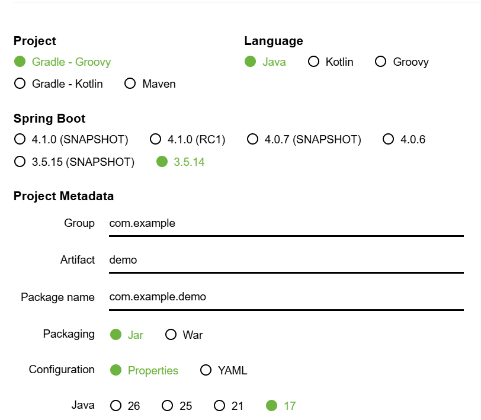

</div>
</div>

<!--
前往 start.spring.io，照著填。

（下一步）Project 選 Gradle - Groovy。

（下一步）Language 選 Java。

（下一步）Spring Boot 的版本保持預設就好，它會是 4 開頭的最新正式版。名字後面有 SNAPSHOT、RC、M 的，是還在測試的版本，不要選。截圖上的版本號和你看到的不一樣沒關係。

（下一步）Group 填 com.example，Artifact 填 demo。這兩個合起來，就是專案的名字和套件的名字。

（下一步）Packaging 選 Jar，Java 選 21，和上一章裝的 JDK 一樣。
-->

---

# 加上 Spring Web，下載

<div class="grid grid-cols-2 gap-6">
<div>

<v-clicks>

1. 點右邊的 **ADD DEPENDENCIES**
2. 搜尋 **Spring Web**，點一下加進清單
3. 按下方的 **GENERATE**，下載 `demo.zip`
4. 解壓縮到 Workspace，例如 `C:\workspace\demo`

</v-clicks>

</div>
<div>

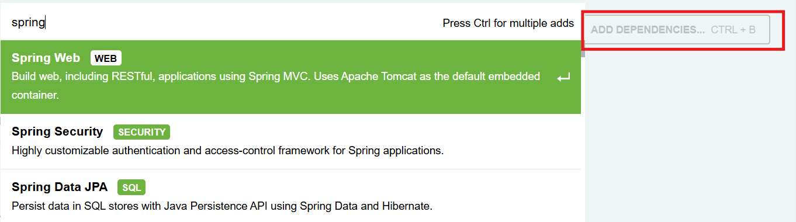

</div>
</div>

<v-click>

<div class="mt-4 p-3 bg-yellow-50 border-l-4 border-yellow-400 text-gray-700 text-left">
⚠️ 路徑一樣<b>不要有中文或空格</b>，否則 Gradle 建構很容易失敗。
</div>

</v-click>

<!--
接下來加上需要的套件。

（下一步）點右邊的 ADD DEPENDENCIES。

（下一步）搜尋 Spring Web，點一下，它就會出現在已選的清單裡。今天只需要這一個。

（下一步）按下方的 GENERATE，瀏覽器會下載 demo.zip。

（下一步）把它解壓縮到上一章設定的 Workspace，例如 C 槽 workspace 底下的 demo 資料夾。

（下一步）提醒一次，路徑不要有中文或空格。
-->

---
layout: section
class: flex flex-col justify-center items-center text-center
---

# Part 3
# 搬上書桌：匯入 Eclipse

<!--
第二步，把專案搬上書桌。
-->

---

# 匯入專案

<div class="grid grid-cols-2 gap-6">
<div>

<v-clicks>

1. Eclipse 選單 **File → Import…**
2. 展開 **Gradle**，選 **Existing Gradle Project**，按 **Next**
3. 按 **Browse…**，選剛才解壓縮的 `demo` 資料夾
4. 按 **Finish**，等 Gradle 下載套件（第一次約 1～3 分鐘）

</v-clicks>

</div>
<div class="flex flex-col gap-3">

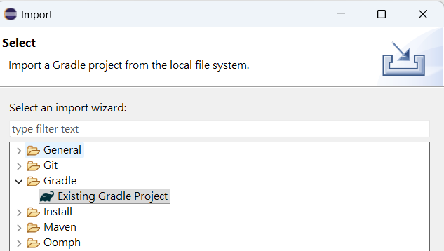

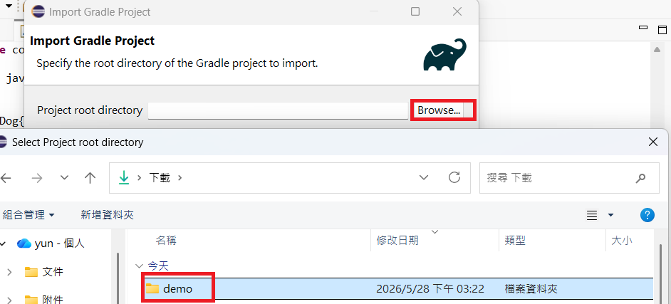

</div>
</div>

<!--
匯入專案。

（下一步）在 Eclipse 上方的選單，點 File，再點 Import。

（下一步）展開 Gradle 資料夾，選 Existing Gradle Project，已經存在的 Gradle 專案。按 Next。

（下一步）按 Browse，選剛才解壓縮的 demo 資料夾。

（下一步）按 Finish。Eclipse 會請 Gradle 開始下載專案需要的套件。第一次比較久，大約一到三分鐘，右下角會顯示進度。請等它跑完。
-->

---

# 工具箱裡有什麼

<div class="grid grid-cols-2 gap-6">
<div>

<v-clicks>

- `src/main/java`：**我們寫程式的地方**
- `src/main/resources`：設定檔 `application.properties`
- `src/test/java`：測試程式（第四十三章）
- `build.gradle`：專案需要哪些套件

</v-clicks>

<v-click>

<div class="mt-4 p-3 bg-blue-50 border-l-4 border-blue-400 text-gray-700 text-left">
💡 <code>src/main/java</code> 裡的 <code>com.example.demo</code> 已經有一個 <code>DemoApplication.java</code>：它是整個程式的<b>啟動點</b>。
</div>

</v-click>

</div>
<div>

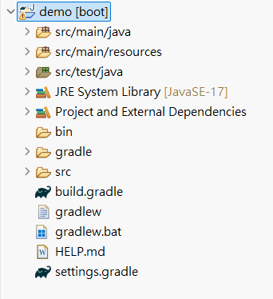

</div>
</div>

<!--
匯入成功之後，看一下左邊的 Package Explorer，工具箱裡有什麼。

（下一步）src/main/java，我們寫程式的地方。

（下一步）src/main/resources，放設定檔，例如 application.properties，第九章會用到。

（下一步）src/test/java，放測試程式，第四十三章會介紹。

（下一步）build.gradle，記錄這個專案需要哪些套件。剛才勾的 Spring Web 就寫在這裡。

（下一步）展開 src/main/java 裡的 com.example.demo，已經有一個 DemoApplication.java。它是整個程式的啟動點，等一下要從它開始執行。
-->

---

# 補充：Gradle 找不到 JDK 21

匯入時如果出現：

```text
Cannot find a Java installation matching: {languageVersion=21}
```

<v-clicks>

- 先確認上一章安裝 JDK 時，有設定 **JAVA_HOME**；重開 Eclipse 再試一次
- 還是不行：打開 `build.gradle`，把 `java { toolchain { … } }` 那一段換成下面這樣，存檔後對專案按右鍵 → **Gradle → Refresh Gradle Project**

</v-clicks>

<v-click>

```groovy
java {
    sourceCompatibility = JavaVersion.VERSION_21
    targetCompatibility = JavaVersion.VERSION_21
}
```

</v-click>

<!--
補充一個常見的問題。匯入的時候，如果出現 Cannot find a Java installation matching languageVersion 21，意思是 Gradle 找不到 JDK 21。

（下一步）先確認上一章安裝 JDK 的時候，有沒有設定 JAVA_HOME。設定之後要把 Eclipse 關掉重開，再匯入一次。

（下一步）還是不行的話，打開 build.gradle，找到 java 大括號 toolchain 那一段，換成下面的寫法。存檔之後，對專案按右鍵，選 Gradle，再選 Refresh Gradle Project。

（下一步）這個寫法的意思是：直接用 Eclipse 正在用的 JDK，編譯成 Java 21 的程式，不要求 Gradle 自己去找。
-->

---
layout: section
class: flex flex-col justify-center items-center text-center
---

# Part 4
# 寫一個櫃台：MyController

<!--
第三步，寫一個櫃台店員。
-->

---

# 新增一個類別

<div class="grid grid-cols-2 gap-6">
<div>

<v-clicks>

1. 對 `com.example.demo` 按右鍵 → **New → Class**
2. Name 填 **`MyController`**
3. 按 **Finish**

</v-clicks>

<v-click>

<div class="mt-4 p-3 bg-blue-50 border-l-4 border-blue-400 text-gray-700 text-left">
💡 <b>類別</b>（class）是 Java 放程式的基本單位。一個類別一個檔案，檔名和類別名稱相同，習慣用大寫開頭。
</div>

</v-click>

</div>
<div class="flex flex-col gap-3">

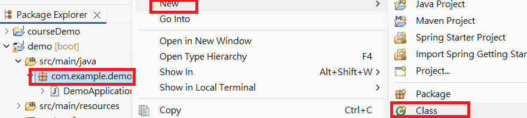

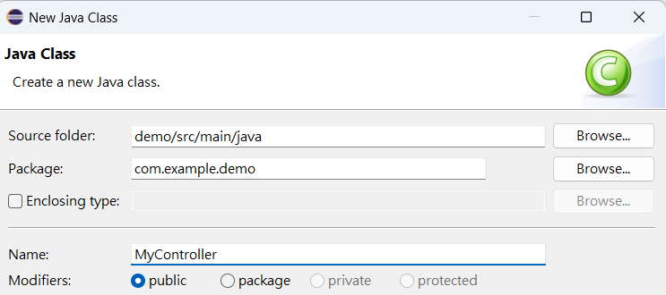

</div>
</div>

<!--
新增一個類別。

（下一步）在 Package Explorer 裡，對 com.example.demo 按右鍵，選 New，再選 Class。

（下一步）Name 填 MyController。Package 已經自動填好了。

（下一步）按 Finish，Eclipse 會建立這個檔案並打開它。

（下一步）類別，英文是 class，是 Java 放程式的基本單位。一個類別一個檔案，檔名和類別名稱相同，習慣用大寫開頭。
-->

---

# 寫上櫃台的工作

<CodeSteps>

```java {6|8|9-12}
package com.example.demo;

import org.springframework.web.bind.annotation.RequestMapping;
import org.springframework.web.bind.annotation.RestController;

@RestController
public class MyController {
    @RequestMapping("/test")
    public String test() {
        System.out.println("Hi!");
        return "Hello World";
    }
}
```

- `@RestController`：告訴 Spring Boot「這個類別是**櫃台**，負責接網址」
- `@RequestMapping("/test")`：店員胸前的名牌，「**`/test` 這個網址由我處理**」
- 方法的內容：在 Console 印出 `Hi!`，再把 `Hello World` 回給瀏覽器

</CodeSteps>

<v-click>

<div class="mt-4 p-3 bg-blue-50 border-l-4 border-blue-400 text-gray-700 text-left">
💡 前面有 <code>@</code> 的叫做 <b>Annotation</b>（註解），像貼在程式上的標籤，告訴 Spring Boot 要怎麼對待它。<code>import</code> 那兩行不用自己打：打完 Annotation 後按 <code>Ctrl + Shift + O</code>，Eclipse 會自動補上。
</div>

</v-click>

<!--
把 MyController 的內容改成這樣。

（下一步）類別上面加 @RestController。意思是告訴 Spring Boot：這個類別是櫃台，負責接網址。

（下一步）方法上面加 @RequestMapping，括號裡是 /test。這就像店員胸前的名牌：/test 這個網址由我處理。

（下一步）方法的內容有兩行。System.out.println 是在 Eclipse 的 Console 印出 Hi!，這是給我們自己看的。return 是把 Hello World 回給瀏覽器，這是給使用者看的。

（下一步）前面有小老鼠符號的，叫做 Annotation，中文也叫註解。它像貼在程式上的標籤，告訴 Spring Boot 要怎麼對待這段程式。上面 import 那兩行不用自己打：打完 Annotation 之後，按 Ctrl 加 Shift 加 O，Eclipse 會自動補上。這兩個 Annotation 第十四章還會詳細介紹。
-->

---
layout: section
class: flex flex-col justify-center items-center text-center
---

# Part 5
# 按下列印鈕

<!--
最後一步，執行。
-->

---

# 執行程式

<div class="grid grid-cols-2 gap-6">
<div>

<v-clicks>

1. 對 **`DemoApplication.java`** 按右鍵
2. 選 **Run As → Java Application**
3. 看下方的 **Console**：出現 `Tomcat started on port 8080` 和 `Started DemoApplication` 就是啟動成功

</v-clicks>

<v-click>

<div class="mt-4 p-3 bg-blue-50 border-l-4 border-blue-400 text-gray-700 text-left">
💡 <b>Tomcat</b> 是 Spring Boot 內建的網站伺服器，就是第一章說的「便利商店的機器」。8080 是它的門牌號碼。
</div>

</v-click>

</div>
<div class="flex flex-col gap-3">

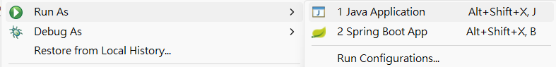

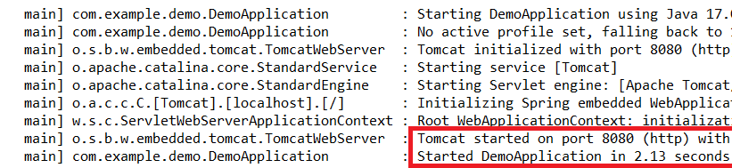

</div>
</div>

<!--
執行程式。

（下一步）對 DemoApplication.java 按右鍵。注意是 DemoApplication，不是 MyController。

（下一步）選 Run As，再選 Java Application。

（下一步）看下方的 Console 視窗，會跑出很多文字。最後出現 Tomcat started on port 8080，和 Started DemoApplication，就是啟動成功了。

（下一步）Tomcat 是 Spring Boot 內建的網站伺服器，就是第一章說的便利商店的機器，插上電就能用。8080 是它的門牌號碼，也就是 Port。
-->

---

# 打開瀏覽器

<div class="grid grid-cols-2 gap-6">
<div>

在網址列輸入：

```text
http://localhost:8080/test
```

<v-clicks>

- 瀏覽器顯示 **Hello World**
- 回到 Eclipse，Console 多了一行 **Hi!**
- `localhost`：「我自己這台電腦」

</v-clicks>

</div>
<div class="flex flex-col gap-3">

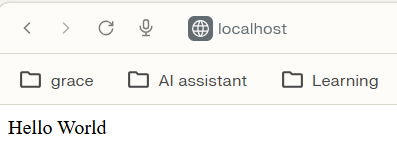

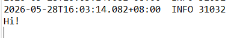

</div>
</div>

<!--
打開瀏覽器，在網址列輸入 http 冒號斜線斜線 localhost 冒號 8080 斜線 test。

（下一步）瀏覽器顯示 Hello World。這是 return 回來的。

（下一步）回到 Eclipse，Console 多了一行 Hi!。這是 System.out.println 印的。代表 test 這個方法真的被執行了。

（下一步）localhost 的意思是：我自己這台電腦。程式在自己的電腦上跑，所以用 localhost 找它。

恭喜大家，完成了第一個 Spring Boot 程式。
-->

---

# 按下 Enter 之後發生了什麼

<Flow nodes="瀏覽器:你打網址的地方|Spring Boot:便利商店的機器|test():櫃台店員 MyController" steps="1>2:打開 localhost:8080/test|2>3:/test？名牌上寫的是你，交給你|3>2:回傳 Hello World（Console 印 Hi!）|2>1:畫面顯示 Hello World" />

<!--
回頭看一下，按下 Enter 之後發生了什麼。

（下一步）瀏覽器送出請求，要 localhost 8080 的 /test。

（下一步）Spring Boot 收到之後，看看哪一位店員的名牌上寫著 /test。找到 MyController 的 test 方法，交給它。

（下一步）test 方法在 Console 印出 Hi!，然後回傳 Hello World。

（下一步）Spring Boot 把 Hello World 送回瀏覽器，畫面顯示出來。

我們只寫了一個類別、一個方法。接電話、找人、送回去，都是 Spring Boot 做的。
-->

---

# 想一想

<Poll question="如果把 @RequestMapping(&quot;/test&quot;) 改成 @RequestMapping(&quot;/hi&quot;)，重新啟動後打開 localhost:8080/test，會看到什麼？" options="Hello World|Hi!|錯誤頁面（找不到 /test）|空白頁面" answer="3" />

<!--
來想一題。如果把 RequestMapping 括號裡的 /test 改成 /hi，重新啟動之後，打開 localhost:8080/test，會看到什麼？

（等大家作答）

（下一步）答案是錯誤頁面，找不到 /test。

店員的名牌換成了 /hi，已經沒有人負責 /test 了。這時候要打開的是 localhost:8080/hi。
-->

---

# 練習：再多一位店員

請在 `MyController` 裡再加一個方法：

<v-clicks>

1. 網址是 `/hello`
2. 在 Console 印出 `有人打招呼`
3. 回給瀏覽器 `你好，Spring Boot`
4. 停止程式（Console 右上角的紅色方塊），再重新執行，打開 `localhost:8080/hello`

</v-clicks>

<v-click>

```java
@RequestMapping("/hello")
public String hello() {
    System.out.println("有人打招呼");
    return "你好，Spring Boot";
}
```

</v-click>

<!--
練習。請在 MyController 裡再加一個方法。

（下一步）網址是 /hello。

（下一步）在 Console 印出「有人打招呼」。

（下一步）回給瀏覽器「你好，Spring Boot」。

（下一步）改完程式要重新執行。先按 Console 右上角的紅色方塊停止程式，再對 DemoApplication 按 Run As。沒有先停止就再執行一次，會因為 8080 已經被佔用而失敗。

請先暫停，自己試試看。

（下一步）參考答案。和 test 方法的寫法一樣，名牌換成 /hello，方法名稱換成 hello，內容換掉就好。新的方法要寫在類別的大括號裡面。
-->

---

# 複習：第一次到便利商店

<Pairs left="便利商店" right="今天做的事" rows="backpack,配好的工具箱=code,start.spring.io：Gradle、Java 21、Spring Web|shop,搬上書桌=code,Eclipse：Import → Existing Gradle Project|clerk,掛名牌的店員=code,@RestController + @RequestMapping(&quot;/test&quot;)|printer,按下列印鈕=code,Run As → Java Application|ok,作業印出來了=browser,localhost:8080/test → Hello World" />

<!--
我們用一張圖複習今天的內容。

（下一步）配好的工具箱，是 start.spring.io，選 Gradle、Java 21，加上 Spring Web。

（下一步）搬上書桌，是 Eclipse 的 Import，選 Existing Gradle Project。

（下一步）掛名牌的店員，是 @RestController 加上 @RequestMapping。

（下一步）按下列印鈕，是 Run As，Java Application。

（下一步）作業印出來了，是瀏覽器打開 localhost:8080/test，看到 Hello World。
-->

---

# 章節總結

<v-clicks>

- **Spring Initializr**：勾選設定和套件，產生一個配好的專案
- **Gradle**：照 `build.gradle` 自動下載套件；匯入時選 Existing Gradle Project
- **`@RestController`**：這個類別是櫃台；**`@RequestMapping("/test")`**：這個網址由我處理
- **執行**：對 `DemoApplication` 按 Run As → Java Application，Tomcat 在 8080 等待
- 改了程式要**先停止再重新執行**

</v-clicks>

<v-click>

下一章：Spring 是怎麼幫我們準備好這些東西的？從「控制反轉」開始。

</v-click>

<!--
最後整理今天的重點。

（依序按下一步）Spring Initializr 勾選設定和套件，產生一個配好的專案。Gradle 照 build.gradle 自動下載套件，匯入的時候選 Existing Gradle Project。@RestController 代表這個類別是櫃台，@RequestMapping 代表這個網址由我處理。執行的時候，對 DemoApplication 按 Run As，Java Application，Tomcat 會在 8080 等待。改了程式，要先停止再重新執行。

（最後一步）今天我們只是走過一遍流程。下一章開始，要看 Spring 是怎麼幫我們準備好這些東西的，從控制反轉開始。
-->

---
layout: end
---

# Q & A

有任何問題嗎？

<!--
今天的內容到這邊。

有任何問題歡迎提出來。
-->
